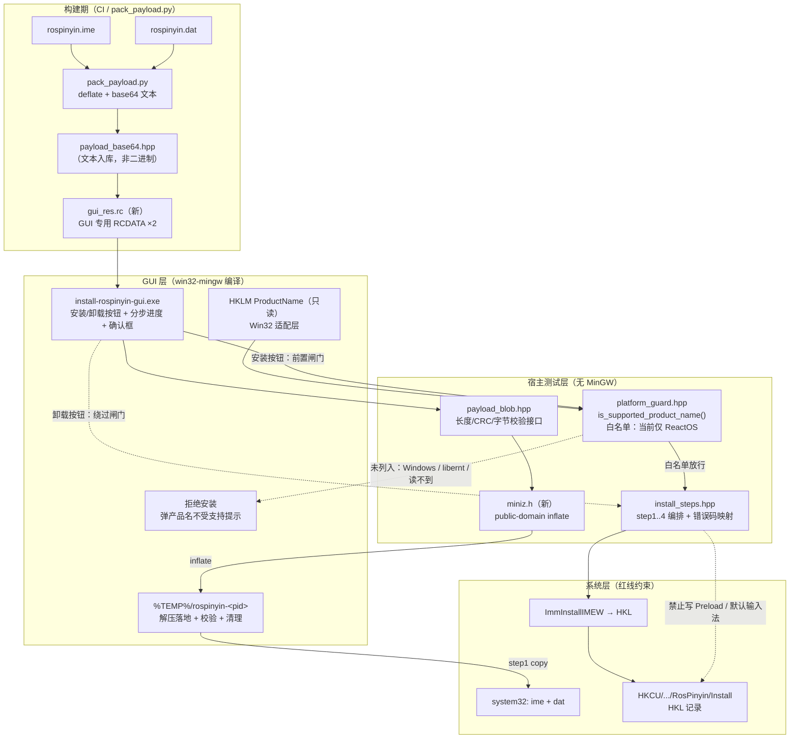

# 需求影响面与技术方案：自包含 GUI 安装器（含 payload 压缩变体评估）

## 一、需求理解与验收标准

一句话：把 `rospinyin.ime` + `rospinyin.dat` 打进一个双击即用的 GUI 安装器，最终用户全程不碰命令行即可完成安装/卸载；红线（不写 Preload、不设默认输入法）不变；同时把「payload 先压缩再内嵌、运行时用轻量解压库释放到 tmp」这一变体（路线 C）与纯内嵌（A）、真 SFX（B）一并评估定案。

可判定的完成条件（沿用 S0 的 AC1–AC7，本轮补充 AC8–AC9）：

- **AC1**：`win32-mingw` preset 编译出 `install-rospinyin-gui.exe`，CI Windows job 构建成功，产物进 release 资产。
- **AC2**：两 payload 内嵌（路线 A/C 为 PE 资源；C 额外要求压缩字节可还原为源文件字节），运行时释放到 `%TEMP%` 唯一子目录，安装后清理；宿主纯逻辑测试校验「释放/解压后字节 == 源字节」。
- **AC3**：GUI 显示安装/卸载两按钮；安装分步显示拷贝/注册/写入进度；重复安装先弹确认；失败弹具体错误码与下一步提示。
- **AC4**：点安装等价于 step1..4（拷贝两文件 + `ImmInstallIMEW` + Layout Text + Layout Display Name），HKL 记录位置与 CLI 一致；不写 Preload、不设默认。
- **AC5**：点卸载等价于 `/u`：删自己的注册表键与两 payload，不动其他布局；占用中删除失败时提示重启清理。
- **AC6**：guest 实机双击安装 → 截图 HKL/文件/Alt+Shift 可切/中文标点冒烟 → 双击卸载 → 截图清理完成。
- **AC7**：双配置 ctest 全绿；`check_m1.py` 红线门禁全绿；`check_docs.py`/`seams.py` 全绿。
- **AC8（本轮修订·P0）**：GUI「安装」按钮采用**严格平台白名单**：当前白名单只含 `ProductName == "ReactOS"`（大小写不敏感）；读不到、类型不符、Windows、`libernt` 等尚未显式列入白名单的兼容分支一律拒绝安装并弹明确提示。后续新增兼容分支（例如 `libernt`）必须先完成实机验证并显式加入白名单，未登记即默认拒绝；卸载按钮不受此限（误装时要能清理）。判据抽成宿主可测纯函数 `is_supported_product_name()`，覆盖 `"ReactOS"`/大小写变体/Windows 值/`libernt`/空串/类型不符。依据：ReactOS 官方论坛 hbelusca 回帖 + ReactOS 自带 `cmd ver.c` 读同一键。
- **AC9（本轮补充）**：release notes 与 README 含「杀毒误报说明」段（未签名说明、SHA256 核验步骤、勿关闭杀软、加白名单指引）；同时写明 **Windows 真机安装只使用 CLI `/step1../step4` 分步方式**，GUI 不提供 Windows 安装入口且会拒绝安装；CLI 行为不改，供开发者/诊断使用。GUI 减少可疑特征（固定临时目录+即时清理、不加密 payload、标准 RCDATA）。不承诺零误报、不购买 EV/OV 证书。

> 专项评估：`docs/reviews/GUI-INSTALLER-FP-AND-WINDOWS-GUARD.md`（含官方来源、判据设计、缓解措施与不做承诺）。

## 二、技术路线

三条路线共用同一套 GUI 交互与 step1..4 安装逻辑，差别**只在 payload 怎么进 exe、怎么用**。实测基线（2026-11-23，源文件 `m0/share/`）：ime 955,897 B、dat 1,080,224 B，合计 2,036,121 B；7z -mx9 分别压到 276,875 B（29.0%）/ 151,872 B（14.1%），合计 428,884 B；zip -mx9 为 525,053 B。GUI 外壳代码预计 30–60 KB。

| 路线 | 做法 | 优点 | 代价 / 风险 | 结论 |
|---|---|---|---|---|
| **A 纯资源内嵌**（S0 基线） | ime+dat 原字节作为 PE RCDATA，运行时写 `%TEMP%` 再拷贝 | 零新依赖、零解压失败点、字节直读最容易审计；构建可复现（windres 输入即源文件） | 产物约 2.04 MB + 外壳；体积是 C 的约 4.7 倍 | 保底可行，留作 C 出问题时的回退 |
| **B 7z/WinZip 真 SFX** | stub + 压缩包 + 配置拼成 exe，双击由 stub 解压并拉起后续程序 | 产物最小（stub 193–213 KB + 428 KB ≈ 623 KB） | ①交互不满足 AC3：SFX 是通用解压进度条，无安装/卸载双按钮、无分步错误码、无覆盖确认，要满足 AC3 得再套一层自写 GUI，SFX 白忙；②兼容风险：实测 stub PE 导入 `OLEAUT32.dll`/`MSVCRT.dll`，非静态 CRT，与本项目「静态链接绕开 ReactOS 缺失 API」路线冲突，0.4.16 无证据；③许可证：stub 为 LGPL，随二进制分发须附 LGPL 声明与源码获取途径，WinZip 更严；④CI 要引入 7z + 固定 stub 版本与时间戳，破坏可复现指纹纪律；⑤stub 另起进程执行安装，注册表写入分散，`check_m1.py` 白名单扫描漏掉真实执行体 | **否决** |
| **C 压缩后资源内嵌 + 轻量解压**（用户要求纳入评估的变体） | 用 miniz 的 deflate 把两 payload 压成压缩字节作为 PE RCDATA；运行时 `mz_inflate`/`tinfl` 解压到 `%TEMP%`，CRC32 + 长度校验后走 step1..4；GUI 交互与 A 完全相同 | 产物约 525 KB（zip deflate）+ 外壳 + miniz 解压路径，体积接近 SFX 但保住全部 GUI 交互；miniz 为 **public domain / Unlicense**、单头文件用法、无 zlib 外部依赖，静态链接与现有 CRT 路线一致；单一代码路径，红线审计仍扫同一份 install 逻辑；构建期用 Python `zlib` 压缩，无需 CI 新工具链 | ①引入一个 public domain 单文件库（只链解压路径）；②多一层「压缩字节→解压→校验」，宿主测试面变大，须补字节往返、损坏 CRC、长度不符三类用例；③压缩引入确定性要求：固定 deflate 级别/时间戳避免 hash 漂移 | **采纳（推荐）** |

**选型理由**：体积不是唯一目标，AC3 的交互与 ReactOS 0.4.16 的兼容性才是硬约束。B 在这两项上都输，还背 LGPL 义务，否决。A 与 C 的 GUI/安装/红线逻辑完全相同，唯一差别是 payload 是否压缩——C 用 525 KB 换来约 1.5 MB 的分发体积下降，代价只是一个 public domain 解压库和三条新测试，收益明显大于代价。C 若解压库集成或可复现性踩坑，回退 A 只需关掉压缩宏、资源段改放原字节，GUI 与安装逻辑零改动（这也是把 A 写进清单 C2 的原因）。

**为什么 C 用 deflate 而不是 7z 的 LZMA**：7z 虽更小（429 KB vs zip 525 KB，省约 96 KB），但 miniz 只做 deflate/zlib 子集、不解 LZMA；要吃 LZMA 得引入 LZMA SDK（多文件、代码量大），与「轻量单文件库」的约束冲突。96 KB 的收益不值得换掉单文件 public domain 的简洁性。7z 的 428 KB 作为对照数据保留，不是 C 的产物预期。

**已定案（owner 已拍板）**：采纳路线 C。依据用户原话「1.C；2.授权」。A 仅作为解压路径集成失败时的回退，回退时 C2/C3/C4 中压缩相关行退化为「资源段直接放原字节」，其余 GUI/平台闸门/文档行不变（见改造清单备注）。

## 三、实现流程

| 步 | 动作 | 依赖 | 验证方式 |
|---|---|---|---|
| 1 | 抽出安装步骤编排为宿主可测纯逻辑模块 `install_steps.hpp`（step1..4 序列、错误码枚举、中文提示映射、进度回调接口），Win32 与注册表调用留在 CLI/GUI 适配层 | — | 宿主单测：正常序列、各步失败短停、错误码→提示映射全覆盖；先红后绿 |
| 2 | 新增 payload 资源编解码纯逻辑模块 `payload_blob.hpp`：压缩字节长度校验、CRC32 校验、解压后大小/字节校验接口；解压实现走新增的 public-domain `tools/install-rospinyin/miniz.h`，接口以回调注入便于宿主测 | 1 | 宿主单测：合法往返、CRC 损坏、长度不符、尾随垃圾四类；先红后绿；miniz 字节往返另测 |
| 2a | 新增平台白名单纯逻辑模块 `platform_guard.hpp`：`is_supported_product_name()` 只放行当前已验证并显式登记的产品名（现为 `ReactOS`，大小写不敏感）；`libernt` 等兼容分支未登记即拒绝。注册表读取留在 GUI 的 Win32 适配层，纯函数只吃字符串 | — | 宿主单测：`ReactOS`/`reactos` 放行，Windows/`libernt`/空串/未列入项拒绝；先红后绿 |
| 3 | 构建期压缩：新增 `tools/install-rospinyin/pack_payload.py`，读 ime+dat → deflate → C 数组/base64 文本落盘（入库为文本，不入库二进制），windres 编进 RCDATA | — | 由脚本产出的 base64 解码后字节 == 源文件；固定 zlib 级别与时间戳，两次构建 hash 一致 |
| 4 | 新增 GUI 专用资源脚本 `tools/install-rospinyin/gui_res.rc`，把压缩后的两个 payload 作为 RCDATA 编进 GUI exe；`ime/rospinyin_res.rc` 与 CLI 安装器资源脚本都不动（偏差裁决：不改正式 .ime，避免 hash/体积漂移） | 3 | 宿主测资源 ID/字节数；CI PE 导入核验；正式 .ime hash 保持不变 |
| 5 | 新增 GUI 工程 `install-rospinyin-gui.exe`：Win32 原生对话框（安装/卸载两按钮）、分步进度、重复安装确认框、错误码中文提示；**安装按钮最前面调用步骤 2a 的平台闸门，拒绝时不进入步骤 1；卸载按钮绕过闸门**；内部调步骤 1 的编排与步骤 2 的解压 | 1,2,2a,4 | CI 编译；宿主闸门单测；guest 实机 AC3/AC4/AC5/AC6；Windows 实机只跑 CLI `/step1..4`，不跑 GUI 安装 |
| 6 | CMake 接入 GUI target（静态 CRT + 可复现 PE + `-mwindows`），CI windows-build 构建，`check_m1.py` 白名单保持 | 5 | 双 preset 构建、PE imports 核验、`check_m1.py` 全绿 |
| 7 | release job 资产清单加入 GUI exe（放在 CLI 之后，CLI 保留给开发者） | 6 | alpha0.0.4 release 6→7 资产，逐一 SHA256 核验 |
| 8 | guest 实机取证 + 文档同步 + 版本 bump alpha0.0.4 | 7 | AC6 截图、check_docs/seams 全绿 |

**顺序理由**：1、2 是纯逻辑底座，宿主 TDD 必须先红后绿，是 5（GUI）的前置阻塞；3 是 4 的资源数据源，必须在 windres 之前；6 依赖 GUI 工程存在；7、8 是发布与取证，放最后。miniz 只在步骤 2 的解压接口里出现，不污染其他层。

## 四、架构图

改动落点：构建期（3）、宿主测试底座（1/2）、GUI 工程（5）、资源脚本（4）、系统写入（沿用现有 install.cpp 逻辑，红线不变）。图里每个框在改造清单都有对应项。

## 五、静态盲区

`blind` 报告 0 处盲区（6 个锚点文件无动态调用/反射/DI/拼装路由）。人工补充两类脚本看不见的：

| 位置 | 类别 | 结论 |
|---|---|---|
| `.github/workflows/ci.yml` release job | 配置驱动的发布行为 | 静态分析看不见 release 资产清单；必须改 `Assemble assets` 步骤把 GUI exe 纳入 `cp` 与 `sha256sum`，否则 CI 构建成功但发版漏资产（AC1 不闭合） |
| `tools/check_m1.py` 注册表白名单扫描 | 配置驱动的安全门禁 | 脚本按常量扫描安装器源码中禁止写入的注册表路径；GUI 复用同一份 step 逻辑即可过门禁，若 GUI 自写注册表调用会绕开扫描——约束：GUI 不得直接写注册表，只调共享的 step 函数 |
| `HKLM\SOFTWARE\Microsoft\Windows NT\CurrentVersion\ProductName` | 环境/配置驱动的运行时判据 | 静态分析看不见真实机器上的产品名；白名单纯函数不依赖注册表 API，Win32 适配层只读该键，读不到/类型不符统一落入拒绝分支；宿主单测覆盖所有分支，实机只在 guest 与（可选）Windows CLI 路径人工确认 |

## 六、实现约束

| 项 | 约束 |
|---|---|
| 命名与分层 | 纯逻辑放 `tools/install-rospinyin/install_steps.hpp`、`payload_blob.hpp`（新增）；Win32/注册表/GUI 只留适配层；不新建平行安装实现，GUI 与 CLI 共享同一套 step 函数 |
| 错误处理 | step1..4 任一失败即短停并把错误码映射成中文提示（含「请重启后重试」）；解压 CRC/长度不符视为 payload 损坏，禁止继续拷贝；不吞异常不写静默失败 |
| 日志 | GUI 分步进度即用户可见日志；命令行适配层沿用 `fwprintf(stderr, ...)`；禁止 `print`/`console.log` 进主干；新增日志须带步骤号 |
| 测试 | 步骤编排、payload 校验、平台白名单三类纯逻辑各补先红后绿用例；平台用例必须含 `ReactOS`/大小写变体/Windows/`libernt`/空串/类型不符；AC7 门禁全绿；CI PE imports 核验保证不引入 `OLEAUT32`/动态 `MSVCRT` |
| 兼容 | CLI `install-rospinyin.exe` 源码与 `/step1..4` 行为完全不动，继续给开发者诊断用；**Windows 真机安装只走 CLI `/step1../step4` 分步方式，GUI 不提供 Windows 安装入口**；红线（不写 Preload、不设默认）在 GUI 与 CLI 两侧都不得突破；路线 C 若回退 A，GUI 与安装逻辑零改动，只改资源段；后续兼容分支（如 `libernt`）须先实机验证再显式加入白名单，未登记默认拒绝 |

## 七、变更意图拆解

| 类型 | 对象 |
|---|---|
| 新增 | 宿主可测纯逻辑模块 `install_steps.hpp`（步骤编排 + 错误码映射） |
| 新增 | 宿主可测纯逻辑模块 `payload_blob.hpp`（长度/CRC/字节校验接口，解压回调注入） |
| 新增 | 宿主可测纯逻辑模块 `platform_guard.hpp`（严格白名单，当前仅 ReactOS） |
| 新增 | public-domain 单头文件 `tools/install-rospinyin/miniz.h`（路线 C 的 inflate 实现，不引系统依赖） |
| 新增 | 构建期压缩脚本 `pack_payload.py` + payload base64 文本头（非二进制入库） |
| 新增 | GUI 工程源码 + `CMakeLists.txt`（新 target `install-rospinyin-gui`） |
| 新增 | GUI 专用 `tools/install-rospinyin/gui_res.rc`（两个 RCDATA；正式 `.ime` 资源不动） |
| 修改 | 根 `CMakeLists.txt` / `CMakePresets.json`（接入 GUI target） |
| 修改 | `.github/workflows/ci.yml`（构建 + release 资产清单，需授权） |
| 修改 | `tools/check_m1.py`（白名单覆盖新增 GUI target，可能需加锚点） |
| 修改 | 版本 `ime/version.h` + release notes alpha0.0.4 + 文档同步 |

## 八、影响面矩阵

| 层级 | 对象 | 是否受影响 | 依据(文件:行) |
|---|---|---|---|
| 工具 | CLI 安装器源码 | 否（行为不动，可被 GUI 复用） | `tools/install-rospinyin/install.cpp:16-31` 步骤定义 |
| 构建 | 安装器 CMake target | 是 | `tools/install-rospinyin/CMakeLists.txt:6` `add_executable` 单点 |
| 资源 | GUI 专用资源脚本 | 是（新增） | 偏差裁决：payload RCDATA 放 `tools/install-rospinyin/gui_res.rc`；`ime/rospinyin_res.rc` 不动，正式 .ime hash/体积不变 |
| 构建 | 根 CMake / preset | 是 | `CMakeLists.txt` 通过子目录纳入 tools |
| CI/CD | 构建与 release job | 是（高危，需授权） | `.github/workflows/ci.yml:79` windows-build、`:260` release |
| 门禁 | 红线扫描 | 是 | `tools/check_m1.py:52` install 相关扫描 |
| 平台 | ProductName 白名单闸门 | 是（新增） | AC8、本节实现约束「兼容」行；只读 HKLM，不进入禁写路径 |
| 发布 | 版本与 release notes | 是 | `ime/version.h`、`docs/releases/` |
| 文档 | HANDOVER/CHANGELOG/ROADMAP | 是 | 25 份 install 相关文档需同步核心三份 |

## 九、改造清单（S3 的验收标准）

| 编号 | 文件:行 | 动作 | 改造理由 | 依据 |
|---|---|---|---|---|
| C1 | `tools/install-rospinyin/install_steps.hpp` (新) | 增 | 步骤编排与错误码映射须宿主可测，且 GUI/CLI 共享单一实现 | S1 §3 步1、§6 分层约束 |
| C2 | `tools/install-rospinyin/payload_blob.hpp` (新) | 增 | 路线 C 的长度/CRC/字节校验接口；回退 A 时此文件保留校验、去掉 inflate 调用 | S1 §3 步2、§2 回退说明 |
| C2a（偏差补充·已授权） | `tools/install-rospinyin/miniz.h` (新) | 增 | public-domain 单头文件提供 deflate inflate；仓库/工具链无 miniz，用户裁决「新增 miniz.h (推荐)」，不引系统 zlib | S1 §2 路线 C；用户裁决原话「新增 miniz.h (推荐)」 |
| C3 | `tools/install-rospinyin/pack_payload.py` (新) | 增 | 构建期 deflate + base64，确定性压缩，文本入库不提交二进制 | S1 §3 步3、§6 兼容 |
| C4 | `tools/install-rospinyin/payload_base64.hpp` (新) | 增 | 压缩后 payload 的文本载体，windres 的输入源 | S1 §3 步3 |
| C5 | `tools/install-rospinyin/gui.cpp` (新) | 增 | Win32 原生 GUI：安装/卸载按钮、分步进度、覆盖确认、错误提示 | AC3、S1 §3 步5 |
| C6（偏差修订·已授权） | `tools/install-rospinyin/gui_res.rc` (新) | 增 | GUI 专用 RCDATA 只进 GUI exe；原方案改 `ime/rospinyin_res.rc` 会把 payload 塞进正式 .ime、改变 hash/体积，用户裁决「新增 GUI 资源脚本 (推荐)」 | S1 §3 步4、用户裁决原话「新增 GUI 资源脚本 (推荐)」 |
| C7 | `tools/install-rospinyin/CMakeLists.txt` | 改 | 新增 GUI target，静态 CRT + 可复现 PE + `-mwindows` | S1 §3 步6、影响面 `CMakeLists.txt:6` |
| C8 | `.github/workflows/ci.yml` | 改 | windows-build 构建 GUI exe + release 资产清单纳入（**高危需授权**） | 敏感预检、S1 §5 配置盲区 |
| C9 | `tools/check_m1.py` | 改 | 白名单覆盖新增 GUI target 与步骤编排模块，保持红线扫描有效 | AC7、影响面 `check_m1.py:52` |
| C10 | `ime/version.h` + `docs/releases/alpha0.0.4.md` (新) | 改/增 | 版本 bump 与发布说明，CI 版本门要求 | S0 发版决策、release 纪律 |
| C11 | `docs/handover/CHANGELOG.md`、`HANDOVER.md`、`docs/plan/ROADMAP.md` | 改 | 同步 GUI 安装器与路线决策 | S1 §8 文档影响面 |
| C12（本轮修订） | `tools/install-rospinyin/platform_guard.hpp` (新) + `gui.cpp` 调用点 | 增 | 严格平台白名单闸门：`is_supported_product_name()` 纯函数（当前仅 ReactOS，大小写不敏感；`libernt` 等未登记兼容分支一律拒绝）+ GUI 安装按钮前置检查（卸载不限）。不改 CLI `/step1..4`，Windows 真机安装保留 CLI 分步路径 | AC8、专项评估 §2.4、官方判据、用户原话「检测非reactOS或后续增加的兼容分支（例如libernt），就拒绝安装。在windows实机安装使用命令行step1..4方式」 |
| C13（本轮修订） | `docs/releases/alpha0.0.4.md`、`README.md`、`docs/reviews/GUI-INSTALLER-FP-AND-WINDOWS-GUARD.md` (新) | 增/改 | 杀毒误报说明段（hash 核验/勿关杀软/加白名单）+ 专项评估落档；明确 Windows 真机只用 CLI `/step1../step4`，GUI 会拒绝；新增兼容分支需先登记白名单 | AC9、专项评估 §1.4 与 §2.5 |

> 15 项，按模块分四组：底座 C1–C4 + C2a（纯逻辑+构建期+解压库），外壳 C5–C7（GUI+资源），发布 C8–C11（CI+门禁+文档），安全补充 C12–C13（平台闸门+误报说明）。路线 A 回退时 C2/C3/C4 退化为原字节资源，C1/C2a/C5–C13 不变。C2a/C6 是 S2 发现的偏差，经用户明确裁决后补入清单。

## 十、授权项 + 依赖图 + 回归范围

**已授权**：`.github/workflows/ci.yml`（高危 CI/CD）——用户原话「1.C；2.授权」，明确同意改动构建步骤与 release 资产清单。CI 版本门与 PE imports 核验作为自动兜底。

**S2 偏差授权**：用户明确选择「新增 GUI 资源脚本 (推荐)」与「新增 miniz.h (推荐)」，据此新增 C6（`gui_res.rc`）与 C2a（`miniz.h`）；正式 `ime/rospinyin_res.rc` 不再改动。

**依赖图**（来自 `依赖图.md`，40 节点 57 边，L0 为 6 个锚点）：新增底座（`install_steps.hpp`/`payload_blob.hpp`/`platform_guard.hpp`/`miniz.h`）为根，GUI 依赖四者与 `gui_res.rc` 的 RCDATA，CI 与门禁依赖 GUI target 存在。改动顺序：C1/C2/C2a/C12 → C3/C4 → C6/C7 → C5 → C8/C9 → C10/C11/C13。

**回归范围**：

| 级别 | 场景 | 理由 |
|---|---|---|
| 必测 | 宿主纯逻辑：step1..4 正常序列 + 每步失败短停 + 错误码映射 | 新增底座，S2 TDD 红绿核心 |
| 必测 | 宿主纯逻辑：payload 合法往返 / CRC 损坏 / 长度不符 / 尾随垃圾 | 路线 C 新增解压层，字节正确性红线 |
| 必测 | 宿主纯逻辑：平台白名单 `ReactOS`/大小写放行；Windows/`libernt`/空串/类型不符/未登记项拒绝 | AC8 防 Windows 与未验证兼容分支误装，白名单式拒绝 |
| 必测 | `check_m1.py` 红线门禁 ON/OFF 双配置 | 确认 GUI 未突破 Preload/默认输入法红线 |
| 必测 | guest：双击安装→HKL/文件/Alt+Shift/中文标点→双击卸载 | AC6 实机闭环 |
| 抽测（若可用） | Windows 真机：只执行 CLI `/step1../step4`，确认四步行为与文档一致；不执行 GUI 安装按钮 | 用户明确 Windows 实机安装走 CLI 分步；避免把未验证 IME 注册进 Windows |
| 抽测 | CI PE imports 无 OLEAUT32/动态 MSVCRT | 路线 C 静态链接声明 |
| 免测 | IME 候选/候选窗/码表逻辑 | 本轮只动安装外壳，IME 本体零改动 |
