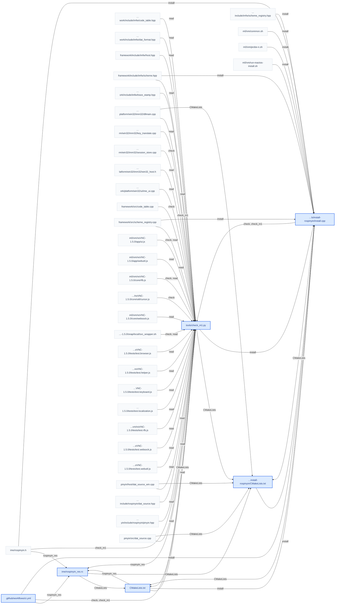

# S1 素材（脚本产出，待补方案）

- 生成时间：2026-11-23 22:26:57
- 锚点文件：6 个

> 下面只是**素材**。技术路线、实现流程、架构图、改造清单必须由你写，`gate` 会拒绝只有素材的报告。

## 影响面

# 变更影响面报告

- 生成时间：2026-11-23 22:26:56
- 对比基线：HEAD
- 改动文件：6 个
- 整体风险：**中**（最高 40/100）

## tools/install-rospinyin/install.cpp  ·  M  ·  风险 40
风险来源：被 17 个文件引用 (+30)；被 25 个文档描述 (+10)
改动：+0 / -0，0 个 hunk
涉及符号：`install`
**调用方（15）**
- `tools/check_m1.py`:52 — install
- `tools/mkdat/build_dat.sh`:9 — install
- `m0/vm/run-reactos-install.sh`:2 — install
- `tools/syntax_stub/windows.h`:8 — install
- `framework/include/imfw/scheme_registry.hpp`:22 — install
- `m0/vm/probe-n.sh`:56 — install
- `ime/rospinyin.h`:14 — install
- `framework/src/scheme_registry.cpp`:24 — install
- `m0/vm/common.sh`:1 — install
- `tools/artifact_hashes.py`:63 — install
- `tools/syntax_stub/imm.h`:8 — install
- `tools/httpdl/http_dl.c`:9 — install
**相关测试（2）**
- `tests/scheme_registry_test.cpp`:10 — install
- `tests/builtin_gate_test.cpp`:10 — install
**相关文档（25）**
- `docs/handover/HANDOVER.md`:204 — install
- `docs/milestones/M0-REDLINE-REVIEW.md`:4 — install
- `docs/milestones/M1-REPORT.md`:53 — install
- `m0/vm/NOVNC-GUIDE.md`:88 — install
- `m0/vm/PRELOAD-PROBE.md`:46 — install
- `libernt/PORTABILITY-ASSESSMENT.md`:51 — install
- `xingma/XINGMA-PLAN.md`:346 — install
- `tools/install-rospinyin/CMakeLists.txt`:6 — install
- `xingma/docs/glyph-tier/GLYPH-TIER-PLAN.md`:5 — install
- `docs/font/FONT-BUNDLING-ASSESSMENT.md`:78 — install
- `docs/handover/CHANGELOG.md`:89 — install
- `docs/reviews/PORTABILITY-UPSTREAM-64BIT-ARM64.md`:98 — install

## tools/install-rospinyin/CMakeLists.txt  ·  M  ·  风险 40
风险来源：被 5 个文件引用 (+15)；无测试引用 (+15)；被 25 个文档描述 (+10)
改动：+0 / -0，0 个 hunk
涉及符号：`CMakeLists`
**调用方（5）**
- `tools/check_m1.py`:188 — CMakeLists
- `tools/install-rospinyin/install.cpp`:438 — CMakeLists
- `framework/platform/win32/imm32/dllmain.cpp`:30 — CMakeLists
- `pinyin/src/dat_source.cpp`:8 — CMakeLists
- `pinyin/host/dat_source_win.cpp`:6 — CMakeLists
**相关测试（0）**
- 无
**相关文档（25）**
- `build-tdd/CMakeFiles/CMakeConfigureLog.yaml`:8 — CMakeLists
- `docs/handover/HANDOVER.md`:178 — CMakeLists
- `build-host-off/CMakeFiles/CMakeConfigureLog.yaml`:8 — CMakeLists
- `build-standalone/CMakeFiles/CMakeConfigureLog.yaml`:8 — CMakeLists
- `build-cross/CMakeFiles/CMakeConfigureLog.yaml`:8 — CMakeLists
- `docs/plan/PLAN-MODULARIZATION.md`:82 — CMakeLists
- `xingma/XINGMA-PLAN.md`:108 — CMakeLists
- `docs/reviews/ARCH-AUDIT-VERIFICATION.md`:30 — CMakeLists
- `docs/handover/CHANGELOG.md`:279 — CMakeLists
- `xingma/archive/XINGMA-PLAN-v2.3-DRAFT.md`:118 — CMakeLists
- `xingma/docs/phase0/PHASE0-PLAN.md`:26 — CMakeLists
- `libernt/PORTABILITY-ASSESSMENT.md`:51 — CMakeLists

## CMakeLists.txt  ·  M  ·  风险 40
风险来源：被 5 个文件引用 (+15)；无测试引用 (+15)；被 25 个文档描述 (+10)
改动：+0 / -0，0 个 hunk
涉及符号：`CMakeLists`
**调用方（5）**
- `tools/check_m1.py`:188 — CMakeLists
- `tools/install-rospinyin/install.cpp`:438 — CMakeLists
- `framework/platform/win32/imm32/dllmain.cpp`:30 — CMakeLists
- `pinyin/src/dat_source.cpp`:8 — CMakeLists
- `pinyin/host/dat_source_win.cpp`:6 — CMakeLists
**相关测试（0）**
- 无
**相关文档（25）**
- `build-tdd/CMakeFiles/CMakeConfigureLog.yaml`:8 — CMakeLists
- `docs/handover/HANDOVER.md`:178 — CMakeLists
- `build-host-off/CMakeFiles/CMakeConfigureLog.yaml`:8 — CMakeLists
- `build-standalone/CMakeFiles/CMakeConfigureLog.yaml`:8 — CMakeLists
- `build-cross/CMakeFiles/CMakeConfigureLog.yaml`:8 — CMakeLists
- `docs/plan/PLAN-MODULARIZATION.md`:82 — CMakeLists
- `xingma/XINGMA-PLAN.md`:108 — CMakeLists
- `docs/reviews/ARCH-AUDIT-VERIFICATION.md`:30 — CMakeLists
- `docs/handover/CHANGELOG.md`:279 — CMakeLists
- `xingma/archive/XINGMA-PLAN-v2.3-DRAFT.md`:118 — CMakeLists
- `xingma/docs/phase0/PHASE0-PLAN.md`:26 — CMakeLists
- `libernt/PORTABILITY-ASSESSMENT.md`:51 — CMakeLists

## tools/check_m1.py  ·  M  ·  风险 40
风险来源：被 37 个文件引用 (+30)；被 25 个文档描述 (+10)
改动：+0 / -0，0 个 hunk
涉及符号：`strip_cpp_comments`, `def_symbols`, `function_body`, `strip_trace_blocks`, `calls_in`, `call_arguments`, `split_top_level`, `reg_key_writes`, `Checker`, `check`, `summary`, `strip_cmake_comments`
**调用方（20）**
- `tools/check_docs.py`:62 — Checker, check, summary
- `tools/check_release_version.py`:24 — check, check_m1
- `tools/ime_chain_diff.py`:158 — summary
- `tools/artifact_hashes.py`:13 — check
- `tools/install-rospinyin/install.cpp`:11 — check, check_m1
- `tools/rhash/rhash.c`:8 — check
- `m0/vm/noVNC-1.5.0/app/ui.js`:1549 — check
- `m0/vm/noVNC-1.5.0/core/rfb.js`:1032 — check
- `m0/vm/noVNC-1.5.0/core/util/cursor.js`:174 — check
- `m0/vm/noVNC-1.5.0/snap/local/svc_wrapper.sh`:19 — check
- `ime/rospinyin.h`:14 — check_m1
- `tools/push_via_api.py`:42 — check
**相关测试（17）**
- `tests/host_key_test.cpp`:37 — check
- `tests/code_table_test.cpp`:13 — check
- `tests/pinyin_session_test.cpp`:19 — check
- `tests/candidate_pager_test.cpp`:15 — check
- `tests/scheme_test.cpp`:23 — check
- `tests/host_smoke_test.cpp`:38 — check
- `tests/toy_scheme_test.cpp`:28 — check
- `tests/emit_text_test.cpp`:21 — check
- `tests/utf8_test.cpp`:19 — check
- `tests/scheme_registry_test.cpp`:28 — check
- `tests/pinyin_test.cpp`:16 — check
- `tests/builtin_gate_test.cpp`:40 — check
**相关文档（25）**
- `docs/handover/HANDOVER.md`:165 — check, check_m1, strip_trace_blocks
- `docs/plan/PLAN-MODULARIZATION.md`:28 — check, check_m1
- `docs/handover/CHANGELOG.md`:24 — check, check_m1
- `xingma/docs/phase0/PHASE0-PLAN.md`:11 — check_m1
- `docs/milestones/M0-REDLINE-REVIEW.md`:4 — check_m1
- `xingma/archive/XINGMA-PLAN-v2.3-DRAFT.md`:83 — check, check_m1
- `xingma/docs/glyph-tier/FRAMEWORK-REQ.md`:4 — check_m1
- `xingma/XINGMA-PLAN.md`:7 — check, check_m1
- `xingma/docs/FRAMEWORK-AUDIT-2026-11-17.md`:10 — check_m1
- `docs/milestones/M1-REPORT.md`:75 — check_m1
- `docs/projectoverall.md`:5 — check_m1
- `docs/plan/PLAN.md`:37 — check_m1

## ime/rospinyin_res.rc  ·  M  ·  风险 31
风险来源：被 2 个文件引用 (+6)；无测试引用 (+15)；被 11 个文档描述 (+10)
改动：+0 / -0，0 个 hunk
涉及符号：`rospinyin_res`
**调用方（2）**
- `tools/check_m1.py`:399 — rospinyin_res
- `ime/rospinyin.h`:13 — rospinyin_res
**相关测试（0）**
- 无
**相关文档（11）**
- `docs/handover/HANDOVER.md`:196 — rospinyin_res
- `docs/handover/CHANGELOG.md`:353 — rospinyin_res
- `ime/CMakeLists.txt`:63 — rospinyin_res
- `docs/font/FONT-BUNDLING-ASSESSMENT.md`:214 — rospinyin_res
- `docs/reviews/ARCH-AUDIT-VERIFICATION.md`:61 — rospinyin_res
- `CMakeLists.txt`:81 — rospinyin_res
- `pinyin/README.md`:11 — rospinyin_res
- `libernt/PORTABILITY-ASSESSMENT.md`:97 — rospinyin_res
- `docs/plan/PLAN.md`:38 — rospinyin_res
- `docs/milestones/M1-REPORT.md`:68 — rospinyin_res
- `docs/milestones/m2/M2-DATA-PLAN.md`:205 — rospinyin_res

## .github/workflows/ci.yml  ·  M  ·  风险 15
风险来源：无测试引用 (+15)
改动：+0 / -0，0 个 hunk
**调用方（0）**
- 无
**相关测试（0）**
- 无
**相关文档（0）**
- 无


## 依赖图

# 改造清单依赖图

- 生成时间：2026-11-23 22:26:57
- 改造文件：6 个
- 关联文件：34 个（展开 2 层）

> 节点过多，已按层级截断 168 个；可收紧 --files 或降低 --depth。

## 终端视图

```
改造范围（L0）
├─ .github/workflows/ci.yml
├─ CMakeLists.txt
│   ├── ← ime/rospinyin_res.rc　(L0，CMakeLists)
│   ├── ← tools/check_m1.py　(L0，CMakeLists)
│   └── ← tools/install-rospinyin/install.cpp　(L0，CMakeLists)
├─ ime/rospinyin_res.rc
│   ├── ← .github/workflows/ci.yml　(L0，rospinyin_res)
│   ├── ← CMakeLists.txt　(L0，rospinyin_res)
│   ├── ← ime/rospinyin.h　(L1，rospinyin_res)
│   └── ← tools/check_m1.py　(L0，rospinyin_res)
├─ tools/check_m1.py
│   ├── ← .github/workflows/ci.yml　(L0，check, check_m1)
│   ├── ← CMakeLists.txt　(L0，read)
│   ├── ← framework/include/imfw/code_table.hpp　(L1，read)
│   ├── ← framework/include/imfw/dat_format.hpp　(L1，read)
│   ├── ← framework/include/imfw/host.hpp　(L1，read)
│   ├── ← framework/include/imfw/scheme.hpp　(L1，read)
│   ├── ← framework/include/imfw/trace_stamp.hpp　(L1，read)
│   └── ← framework/platform/win32/imm32/dllmain.cpp　(L1，check_m1)
│   └── …… 另有 61 个依赖方
├─ tools/install-rospinyin/CMakeLists.txt
│   ├── ← framework/platform/win32/imm32/dllmain.cpp　(L1，CMakeLists)
│   ├── ← ime/rospinyin_res.rc　(L0，CMakeLists)
│   ├── ← pinyin/host/dat_source_win.cpp　(L1，CMakeLists)
│   ├── ← pinyin/src/dat_source.cpp　(L1，CMakeLists)
│   ├── ← tools/check_m1.py　(L0，CMakeLists)
│   └── ← tools/install-rospinyin/install.cpp　(L0，CMakeLists)
├─ tools/install-rospinyin/install.cpp
│   ├── ← .github/workflows/ci.yml　(L0，install)
│   ├── ← CMakeLists.txt　(L0，install)
│   ├── ← framework/include/imfw/scheme.hpp　(L1，install)
│   ├── ← framework/include/imfw/scheme_registry.hpp　(L1，install)
│   ├── ← framework/src/scheme_registry.cpp　(L1，install)
│   ├── ← ime/rospinyin.h　(L1，install)
│   ├── ← m0/vm/common.sh　(L1，install)
│   └── ← m0/vm/probe-n.sh　(L1，install)
│   └── …… 另有 12 个依赖方
```

## 图（Mermaid）



## 分层

**改造范围（S1 清单内）**（6）
- `.github/workflows/ci.yml`
- `CMakeLists.txt`
- `ime/rospinyin_res.rc`
- `tools/check_m1.py`
- `tools/install-rospinyin/CMakeLists.txt`
- `tools/install-rospinyin/install.cpp`

**直接受影响**（34）
- `framework/include/imfw/code_table.hpp`
- `framework/include/imfw/dat_format.hpp`
- `framework/include/imfw/host.hpp`
- `framework/include/imfw/scheme.hpp`
- `framework/include/imfw/scheme_registry.hpp`
- `framework/include/imfw/trace_stamp.hpp`
- `framework/platform/win32/imm32/dllmain.cpp`
- `framework/platform/win32/imm32/key_translate.cpp`
- `framework/platform/win32/imm32/session_store.cpp`
- `framework/platform/win32/imm32/win32_host.h`
- `framework/platform/win32/ui/ime_ui.cpp`
- `framework/src/code_table.cpp`
- `framework/src/scheme_registry.cpp`
- `ime/rospinyin.h`
- `m0/vm/common.sh`
- `m0/vm/noVNC-1.5.0/app/ui.js`
- `m0/vm/noVNC-1.5.0/app/webutil.js`
- `m0/vm/noVNC-1.5.0/core/rfb.js`
- `m0/vm/noVNC-1.5.0/core/util/cursor.js`
- `m0/vm/noVNC-1.5.0/core/websock.js`
- `m0/vm/noVNC-1.5.0/snap/local/svc_wrapper.sh`
- `m0/vm/noVNC-1.5.0/tests/test.browser.js`
- `m0/vm/noVNC-1.5.0/tests/test.helper.js`
- `m0/vm/noVNC-1.5.0/tests/test.keyboard.js`
- `m0/vm/noVNC-1.5.0/tests/test.localization.js`
- `m0/vm/noVNC-1.5.0/tests/test.rfb.js`
- `m0/vm/noVNC-1.5.0/tests/test.websock.js`
- `m0/vm/noVNC-1.5.0/tests/test.webutil.js`
- `m0/vm/probe-n.sh`
- `m0/vm/run-reactos-install.sh`
- `pinyin/host/dat_source_win.cpp`
- `pinyin/include/rospinyin/dat_source.hpp`
- `pinyin/include/rospinyin/pinyin.hpp`
- `pinyin/src/dat_source.cpp`

## 依赖关系

| 依赖方 | 被依赖 | 引用符号 |
|---|---|---|
| `.github/workflows/ci.yml` | `ime/rospinyin_res.rc` | rospinyin_res |
| `.github/workflows/ci.yml` | `tools/check_m1.py` | check, check_m1 |
| `.github/workflows/ci.yml` | `tools/install-rospinyin/install.cpp` | install |
| `CMakeLists.txt` | `ime/rospinyin_res.rc` | rospinyin_res |
| `CMakeLists.txt` | `tools/check_m1.py` | read |
| `CMakeLists.txt` | `tools/install-rospinyin/install.cpp` | install |
| `build-cross/CMakeFiles/4.5.1/CompilerIdC/CMakeCCompilerId.c` | `framework/platform/win32/imm32/session_store.cpp` | Store |
| `build-cross/CMakeFiles/4.5.1/CompilerIdC/CMakeCCompilerId.c` | `m0/vm/noVNC-1.5.0/core/util/cursor.js` | change |
| `build-cross/CMakeFiles/4.5.1/CompilerIdC/CMakeCCompilerId.c` | `tools/artifact_hashes.py` | when |
| `build-cross/CMakeFiles/4.5.1/CompilerIdC/CMakeCCompilerId.c` | `tools/syntax_stub/windows.h` | windows |
| `build-cross/CMakeFiles/4.5.1/CompilerIdCXX/CMakeCXXCompilerId.cpp` | `framework/platform/win32/imm32/session_store.cpp` | Store |
| `build-cross/CMakeFiles/4.5.1/CompilerIdCXX/CMakeCXXCompilerId.cpp` | `m0/vm/noVNC-1.5.0/core/util/cursor.js` | change |
| `build-cross/CMakeFiles/4.5.1/CompilerIdCXX/CMakeCXXCompilerId.cpp` | `tools/artifact_hashes.py` | when |
| `build-cross/CMakeFiles/4.5.1/CompilerIdCXX/CMakeCXXCompilerId.cpp` | `tools/syntax_stub/windows.h` | windows |
| `build-host-off/CMakeFiles/4.5.1/CompilerIdC/CMakeCCompilerId.c` | `framework/platform/win32/imm32/session_store.cpp` | Store |
| `build-host-off/CMakeFiles/4.5.1/CompilerIdC/CMakeCCompilerId.c` | `m0/vm/noVNC-1.5.0/core/util/cursor.js` | change |
| `build-host-off/CMakeFiles/4.5.1/CompilerIdC/CMakeCCompilerId.c` | `tools/artifact_hashes.py` | when |
| `build-host-off/CMakeFiles/4.5.1/CompilerIdC/CMakeCCompilerId.c` | `tools/syntax_stub/windows.h` | windows |
| `build-host-off/CMakeFiles/4.5.1/CompilerIdCXX/CMakeCXXCompilerId.cpp` | `framework/platform/win32/imm32/session_store.cpp` | Store |
| `build-host-off/CMakeFiles/4.5.1/CompilerIdCXX/CMakeCXXCompilerId.cpp` | `m0/vm/noVNC-1.5.0/core/util/cursor.js` | change |
| `build-host-off/CMakeFiles/4.5.1/CompilerIdCXX/CMakeCXXCompilerId.cpp` | `tools/artifact_hashes.py` | when |
| `build-host-off/CMakeFiles/4.5.1/CompilerIdCXX/CMakeCXXCompilerId.cpp` | `tools/syntax_stub/windows.h` | windows |
| `build-host-off/pinyin/CMakeFiles/rospinyin-engine.dir/compiler_depend.ts` | `ime/rospinyin.h` | rospinyin |
| `build-host-off/tests/CMakeFiles/rospinyin-builtin-gate.dir/compiler_depend.ts` | `ime/rospinyin.h` | rospinyin |
| `build-host-off/tests/CMakeFiles/rospinyin-candidate-pager.dir/compiler_depend.ts` | `ime/rospinyin.h` | rospinyin |
| `build-host-off/tests/CMakeFiles/rospinyin-code-table.dir/compiler_depend.ts` | `ime/rospinyin.h` | rospinyin |
| `build-host-off/tests/CMakeFiles/rospinyin-emit-text.dir/compiler_depend.ts` | `ime/rospinyin.h` | rospinyin |
| `build-host-off/tests/CMakeFiles/rospinyin-host-key.dir/compiler_depend.ts` | `framework/include/imfw/host.hpp` | host |
| `build-host-off/tests/CMakeFiles/rospinyin-host-key.dir/compiler_depend.ts` | `ime/rospinyin.h` | rospinyin |
| `build-host-off/tests/CMakeFiles/rospinyin-host-smoke.dir/compiler_depend.ts` | `framework/include/imfw/host.hpp` | host |
| `build-host-off/tests/CMakeFiles/rospinyin-host-smoke.dir/compiler_depend.ts` | `ime/rospinyin.h` | rospinyin |
| `build-host-off/tests/CMakeFiles/rospinyin-key-char.dir/compiler_depend.ts` | `ime/rospinyin.h` | rospinyin |
| `build-host-off/tests/CMakeFiles/rospinyin-key-route.dir/compiler_depend.ts` | `ime/rospinyin.h` | rospinyin |
| `build-host-off/tests/CMakeFiles/rospinyin-pinyin-session.dir/compiler_depend.ts` | `ime/rospinyin.h` | rospinyin |
| `build-host-off/tests/CMakeFiles/rospinyin-pinyin-session.dir/compiler_depend.ts` | `pinyin/include/rospinyin/pinyin.hpp` | pinyin |
| `build-host-off/tests/CMakeFiles/rospinyin-pinyin.dir/compiler_depend.ts` | `ime/rospinyin.h` | rospinyin |
| `build-host-off/tests/CMakeFiles/rospinyin-pinyin.dir/compiler_depend.ts` | `pinyin/include/rospinyin/pinyin.hpp` | pinyin |
| `build-host-off/tests/CMakeFiles/rospinyin-punctuation.dir/compiler_depend.ts` | `ime/rospinyin.h` | rospinyin |
| `build-host-off/tests/CMakeFiles/rospinyin-scheme-registry.dir/compiler_depend.ts` | `framework/include/imfw/scheme.hpp` | scheme |
| `build-host-off/tests/CMakeFiles/rospinyin-scheme-registry.dir/compiler_depend.ts` | `ime/rospinyin.h` | rospinyin |
| `build-host-off/tests/CMakeFiles/rospinyin-scheme.dir/compiler_depend.ts` | `framework/include/imfw/scheme.hpp` | scheme |
| `build-host-off/tests/CMakeFiles/rospinyin-scheme.dir/compiler_depend.ts` | `ime/rospinyin.h` | rospinyin |
| `build-host-off/tests/CMakeFiles/rospinyin-session.dir/compiler_depend.ts` | `ime/rospinyin.h` | rospinyin |
| `build-host-off/tests/CMakeFiles/rospinyin-smoke.dir/compiler_depend.ts` | `ime/rospinyin.h` | rospinyin |
| `build-host-off/tests/CMakeFiles/rospinyin-toolbar-text.dir/compiler_depend.ts` | `ime/rospinyin.h` | rospinyin |
| `build-host-off/tests/CMakeFiles/rospinyin-toy-scheme.dir/compiler_depend.ts` | `framework/include/imfw/scheme.hpp` | scheme |
| `build-host-off/tests/CMakeFiles/rospinyin-toy-scheme.dir/compiler_depend.ts` | `ime/rospinyin.h` | rospinyin |
| `build-host-off/tests/CMakeFiles/rospinyin-utf8.dir/compiler_depend.ts` | `ime/rospinyin.h` | rospinyin |
| `build-standalone/CMakeFiles/4.5.0/CompilerIdC/CMakeCCompilerId.c` | `framework/platform/win32/imm32/session_store.cpp` | Store |
| `build-standalone/CMakeFiles/4.5.0/CompilerIdC/CMakeCCompilerId.c` | `m0/vm/noVNC-1.5.0/core/util/cursor.js` | change |
| `build-standalone/CMakeFiles/4.5.0/CompilerIdC/CMakeCCompilerId.c` | `tools/artifact_hashes.py` | when |
| `build-standalone/CMakeFiles/4.5.0/CompilerIdC/CMakeCCompilerId.c` | `tools/syntax_stub/windows.h` | windows |
| `build-standalone/CMakeFiles/4.5.0/CompilerIdCXX/CMakeCXXCompilerId.cpp` | `framework/platform/win32/imm32/session_store.cpp` | Store |
| `build-standalone/CMakeFiles/4.5.0/CompilerIdCXX/CMakeCXXCompilerId.cpp` | `m0/vm/noVNC-1.5.0/core/util/cursor.js` | change |
| `build-standalone/CMakeFiles/4.5.0/CompilerIdCXX/CMakeCXXCompilerId.cpp` | `tools/artifact_hashes.py` | when |
| `build-standalone/CMakeFiles/4.5.0/CompilerIdCXX/CMakeCXXCompilerId.cpp` | `tools/syntax_stub/windows.h` | windows |
| `build-tdd/CMakeFiles/4.5.0/CompilerIdC/CMakeCCompilerId.c` | `framework/platform/win32/imm32/session_store.cpp` | Store |
| `build-tdd/CMakeFiles/4.5.0/CompilerIdC/CMakeCCompilerId.c` | `m0/vm/noVNC-1.5.0/core/util/cursor.js` | change |
| `build-tdd/CMakeFiles/4.5.0/CompilerIdC/CMakeCCompilerId.c` | `tools/artifact_hashes.py` | when |
| `build-tdd/CMakeFiles/4.5.0/CompilerIdC/CMakeCCompilerId.c` | `tools/syntax_stub/windows.h` | windows |
| `build-tdd/CMakeFiles/4.5.0/CompilerIdCXX/CMakeCXXCompilerId.cpp` | `framework/platform/win32/imm32/session_store.cpp` | Store |
| `build-tdd/CMakeFiles/4.5.0/CompilerIdCXX/CMakeCXXCompilerId.cpp` | `m0/vm/noVNC-1.5.0/core/util/cursor.js` | change |
| `build-tdd/CMakeFiles/4.5.0/CompilerIdCXX/CMakeCXXCompilerId.cpp` | `tools/artifact_hashes.py` | when |
| `build-tdd/CMakeFiles/4.5.0/CompilerIdCXX/CMakeCXXCompilerId.cpp` | `tools/syntax_stub/windows.h` | windows |
| `build-tdd/CMakeFiles/4.5.1/CompilerIdC/CMakeCCompilerId.c` | `framework/platform/win32/imm32/session_store.cpp` | Store |
| `build-tdd/CMakeFiles/4.5.1/CompilerIdC/CMakeCCompilerId.c` | `m0/vm/noVNC-1.5.0/core/util/cursor.js` | change |
| `build-tdd/CMakeFiles/4.5.1/CompilerIdC/CMakeCCompilerId.c` | `tools/artifact_hashes.py` | when |
| `build-tdd/CMakeFiles/4.5.1/CompilerIdC/CMakeCCompilerId.c` | `tools/syntax_stub/windows.h` | windows |
| `build-tdd/CMakeFiles/4.5.1/CompilerIdCXX/CMakeCXXCompilerId.cpp` | `framework/platform/win32/imm32/session_store.cpp` | Store |
| `build-tdd/CMakeFiles/4.5.1/CompilerIdCXX/CMakeCXXCompilerId.cpp` | `m0/vm/noVNC-1.5.0/core/util/cursor.js` | change |
| `build-tdd/CMakeFiles/4.5.1/CompilerIdCXX/CMakeCXXCompilerId.cpp` | `tools/artifact_hashes.py` | when |
| `build-tdd/CMakeFiles/4.5.1/CompilerIdCXX/CMakeCXXCompilerId.cpp` | `tools/syntax_stub/windows.h` | windows |
| `framework/include/imfw/candidate_pager.hpp` | `framework/include/imfw/host.hpp` | host |
| `framework/include/imfw/candidate_pager.hpp` | `pinyin/include/rospinyin/pinyin.hpp` | pinyin |
| `framework/include/imfw/candidate_pager.hpp` | `tools/artifact_hashes.py` | when |
| `framework/include/imfw/code_table.hpp` | `tools/check_m1.py` | read |
| `framework/include/imfw/dat_format.hpp` | `tools/check_m1.py` | read |
| `framework/include/imfw/emit_text.hpp` | `framework/include/imfw/host.hpp` | host |
| `framework/include/imfw/emit_text.hpp` | `pinyin/include/rospinyin/pinyin.hpp` | pinyin |
| `framework/include/imfw/emit_text.hpp` | `tools/artifact_hashes.py` | when |
| `framework/include/imfw/emit_text.hpp` | `tools/compare_ime.py` | runs |
| `framework/include/imfw/emit_text.hpp` | `tools/push_via_api.py` | call |
| `framework/include/imfw/engine.hpp` | `framework/include/imfw/host.hpp` | host |
| `framework/include/imfw/engine.hpp` | `pinyin/include/rospinyin/pinyin.hpp` | pinyin |
| `framework/include/imfw/host.hpp` | `tools/check_m1.py` | read |
| `framework/include/imfw/intent.hpp` | `framework/include/imfw/host.hpp` | KeyEvent, host |
| `framework/include/imfw/intent.hpp` | `framework/include/imfw/scheme.hpp` | Scheme, scheme |
| `framework/include/imfw/intent.hpp` | `m0/vm/noVNC-1.5.0/core/util/cursor.js` | change |
| `framework/include/imfw/intent.hpp` | `pinyin/include/rospinyin/pinyin.hpp` | Reading |
| `framework/include/imfw/intent.hpp` | `tests/key_route_test.cpp` | key_route_test |
| `framework/include/imfw/intent.hpp` | `tools/artifact_hashes.py` | when |
| `framework/include/imfw/intent.hpp` | `tools/compare_ime.py` | runs |
| `framework/include/imfw/intent.hpp` | `tools/ime_chain_diff.py` | pick |
| `framework/include/imfw/intent.hpp` | `tools/push_via_api.py` | call |
| `framework/include/imfw/key_char.hpp` | `framework/include/imfw/host.hpp` | host |
| `framework/include/imfw/key_char.hpp` | `framework/platform/win32/imm32/key_translate.cpp` | key_translate |
| `framework/include/imfw/key_char.hpp` | `tools/push_via_api.py` | call |
| `framework/include/imfw/key_char.hpp` | `tools/syntax_stub/windows.h` | windows |
| `framework/include/imfw/punctuation.hpp` | `framework/include/imfw/host.hpp` | host |
| `framework/include/imfw/punctuation.hpp` | `framework/include/imfw/scheme.hpp` | scheme |
| `framework/include/imfw/punctuation.hpp` | `pinyin/include/rospinyin/pinyin.hpp` | pinyin |
| `framework/include/imfw/punctuation.hpp` | `tests/punctuation_test.cpp` | punctuation_test |
| `framework/include/imfw/punctuation.hpp` | `tools/artifact_hashes.py` | when |
| `framework/include/imfw/scheme.hpp` | `tools/check_m1.py` | read |
| `framework/include/imfw/scheme.hpp` | `tools/install-rospinyin/install.cpp` | install |
| `framework/include/imfw/scheme_registry.hpp` | `tools/install-rospinyin/install.cpp` | install |
| `framework/include/imfw/session.hpp` | `framework/include/imfw/host.hpp` | host |
| `framework/include/imfw/session.hpp` | `pinyin/include/rospinyin/pinyin.hpp` | pinyin |
| `framework/include/imfw/session_state.hpp` | `framework/include/imfw/host.hpp` | host |
| `framework/include/imfw/session_state.hpp` | `framework/platform/win32/imm32/session_store.cpp` | session_store |
| `framework/include/imfw/session_state.hpp` | `m0/vm/noVNC-1.5.0/core/rfb.js` | focus |
| `framework/include/imfw/session_state.hpp` | `m0/vm/noVNC-1.5.0/core/util/cursor.js` | change |
| `framework/include/imfw/session_state.hpp` | `tools/artifact_hashes.py` | when |
| `framework/include/imfw/toolbar_text.hpp` | `framework/include/imfw/host.hpp` | host |
| `framework/include/imfw/toolbar_text.hpp` | `framework/include/imfw/scheme.hpp` | Scheme, scheme |
| `framework/include/imfw/toolbar_text.hpp` | `tests/toolbar_text_test.cpp` | toolbar_text_test |
| `framework/include/imfw/toolbar_text.hpp` | `tools/artifact_hashes.py` | when |
| `framework/include/imfw/toolbar_text.hpp` | `tools/syntax_stub/windows.h` | windows |
| `framework/include/imfw/trace_stamp.hpp` | `tools/check_m1.py` | read |
| `framework/include/imfw/utf8.hpp` | `framework/include/imfw/host.hpp` | host |


## 静态盲区

# 静态分析盲区

- 生成时间：2026-11-23 22:26:57
- 检查文件：6 个
- 盲区：0 处

这些文件里没有发现动态调用、反射、DI、拼装路由等写法。

> 只代表「没有命中已知模式」。跨服务的调用、配置驱动的行为，静态分析一律看不见。

