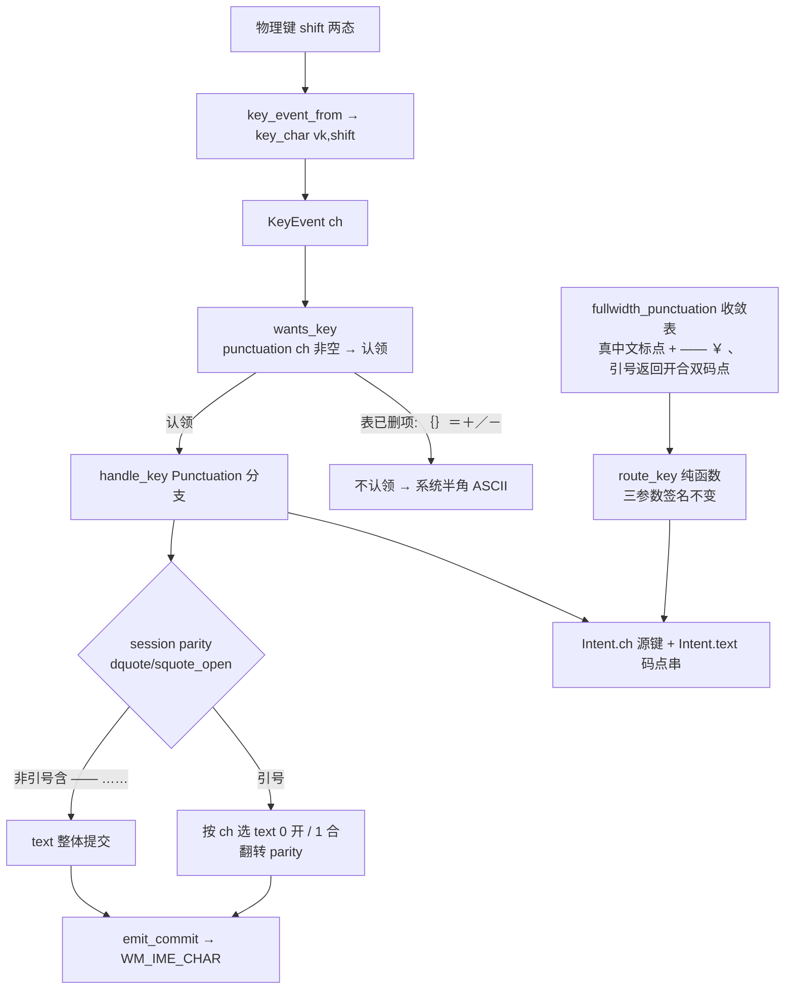

# S1 需求影响面与技术方案（v5 · M3 标点表收敛 + 引号交替）

- 轮次：M3 中文体验补齐：中文标点、全角/半角、中英状态记忆、Shift 临时英文、Ctrl+Space 热键、状态提示
- 版本：v5（v4 只覆盖引号，本版并入 owner 20:20/20:25 的标点范围决策，取代 v4）
- 生成时间：2026-11-23 20:28
- 需求来源：`.devloop/S0-需求澄清.md` v4（owner「选方案1，单引号也是相同处理」+「shift+-为——…」+ 弹窗三项决策）
- 实证：`punct_audit` 枚举全键盘 vk×shift 两态的实际 `key_char` + `fullwidth_punctuation` 输出（见 §1）

---

## 1. 需求理解与验收标准

一句话：把共享标点表从「机械全角化」收敛为**只保留真中文标点**——新增 `——` / `￥` / `、`、引号改交替 `“”` `‘’`、移除纯全角形态符号（留半角给后续全角功能），同时保持 route_key 纯函数契约与既有 Shift 修复不回退。

**实证数据（`/home/twipty/.workbuddy/tmp/punct_audit`，枚举 21 键 × 2 态）**：

| 类别 | 当前表值 | owner 判定 |
|---|---|---|
| 真中文标点（Unicode CJK/fullwidth 中文标准码点） | `，。？！：；（）【】《》……～` | ✅ 保留（`～` 属中文范围号，`！～；` 已确认正常） |
| 点名新增 | shift+`-`(`_`)→`＿`、`$`→无、`\`→`＼` | ❌ 改为 `——`(U+2014×2)、`￥`(U+FFE5)、`、`(U+3001) |
| 引号 | `"`→`＂`(U+FF02)、`'`→`＇`(U+FF07) | ❌ 改为交替 `“”`(U+201C/D)、`‘’`(U+2018/9) |
| 纯全角形态（中文无标准对应） | `{`→`｝`、`}`→`｝`、`/`→`／`、`-`→`－`、`+`→`＋`、`=`→`＝` | ❌ 移除，中文态走系统半角；全角功能后续独立做 |

**关键澄清（已由 owner 拍板）**：`\`（不按 shift）出 `、`，不是 `|`（shift+`\`）——US 布局下反斜杠键不按 shift 即 U+005C，符合中文输入法惯例；`|` 保持无映射。

可判定验收标准：

1. `punctuation_test`：新增 `_`→`U+2014 U+2014`、`$`→`U+FFE5`、`\`→`U+3001`、`"`→`U+201C U+201D`、`'`→`U+2018 U+2019` 五条断言。
2. `punctuation_test`：`{` `}` `/` `-` `+` `=` 六条从断言全角改为 `expect_none`（无映射→半角）。
3. `punctuation_test`：真中文标点 14 条（`，。？！：；（）【】《》……～`）保持断言不变，防回退。
4. `host_key_test`：引号交替 ×3、嵌套、英文态不推进、组合中不推进（v4 验收 2-4 不变）；`……`/`——` 双码点整体提交不被 parity 截断。
5. `host_key_test` 或 `punctuation_test`：`$` 由数字行 shift+4 产出（U+0024），确认 `key_char(0x34,true)='$'` 与表 U+0024 条目串起来。
6. guest 实机：中文态连按 `"` `'` 各 ≥3 次出交替弯引号；`shift+-`→`——`、`shift+4`→`￥`、`\`→`、`；英文态下 `{ } / - + = $ \` 仍为半角 ASCII；dat 指纹 `db0c7bcf`、zhong `[快]`5/`[全]`12 页不回退。
7. 门禁全绿：ctest 双配置、check_m1 111/111、check_docs 7/7、check_mkdat OK、seams 全在 cap；X2-c 三参数签名不变。

## 2. 技术路线

| 路线 | 做法 | 优点 | 代价 | 结论 |
|---|---|---|---|---|
| A（选中，v4 延续） | 表对引号/`——` 返回双码点；parity 放 `ImeSessionState`；`handle_key` Punctuation 分支按 `intent.ch` 判引号→按 parity 取 text[0]/1 上屏并翻转。表值收敛：新增 3 条、删 6 条、改 2 条引号 | `route_key` 三参数纯函数契约不变（X2-c 不动）；表仍无状态、singma 复用无死角；parity 天然 per-HIMC；一张表同时表达「多码点」与「无映射=半角」 | 提交分支多一个短分支；旧测试 6 条要改成 expect_none | **采纳** |
| B（淘汰） | 给 `route_key`/`Scheme::punctuation` 加 parity 参数 | 提交层零改动 | 破坏 check_m1 X2-c 钉死签名；把输入过程事实塞进语言层表，违反分层 | 否决 |
| C（淘汰） | 保留全部全角符号，另加「全角模式」开关在提交层二次映射 | 表不用删条目 | 与 owner「无中文对应一律回退半角，全角留后续」决策冲突；本轮引入开关超出 S0 锁定边界 | 否决 |

**为什么移除纯全角符号是安全的**：`wants_key` 的认领判据是 `!scheme.punctuation(event.ch).empty()`（host_key.cpp:201-212）；表项删掉后这些键在中文态空组合下**不再被 IME 认领**，按键落给应用，由系统 US 布局输出半角——正是 owner 要的「回退半角」。无需改 wants_key 或平台层。

**为什么 `￥` 不算「纯全角形态」**：它是人民币符号的标准中文码点（owner 点名要），不是 ASCII `$` 的机械全角化；纳入真中文标点集合。

## 3. 实现流程

| 步 | 动作 | 依赖 | 验证 |
|---|---|---|---|
| 1 | 红灯一：改 `punctuation_test` 新增 5 条 + 删 6 条全角断言为 expect_none + 保留 14 条 | 无 | 编译过但断言失败即红灯，贴输出 |
| 2 | 红灯二：`host_key_test` 加引号交替 ×3/嵌套/英文态/组合中 + 双码点不被截断 | 无 | 红灯输出 |
| 3 | 绿灯表：`punctuation.hpp` 一次改完——新增 `_`/`$`/`\` 3 条、`"`/`'` 2 条引号对、删 `{`/`}`/`/`/`-`/`+`/`=` 6 条 | 步 1 | punctuation_test 转绿 |
| 4 | 绿灯状态：`session_state.hpp` 加 `dquote_open`/`squote_open`（默认 true） | 步 2 | 编译通过 |
| 5 | 绿灯提交：`host_key.cpp` Punctuation 分支按 ch 判引号→parity 选 text[0]/1→翻转；其余（`……`/`——`）整体提交 | 步 4 | host_key_test 转绿 |
| 6 | 门禁：ctest 双配置、check_m1、check_docs、check_mkdat、seams 复核 | 步 5 | 全绿，X2-c 签名与 cap 未放宽 |
| 7 | 重建 release `.ime` → HTTP 部署 → owner `/step1` + 重启 → 实机验收 6 | 步 6 | agent 抓图 + owner 确认 |
| 8 | 文档：CHANGELOG/ROADMAP 记录标点表收敛与引号交替 | 步 7 | check_docs 7/7 |

顺序理由：两张红灯测试先立（表值 + 行为），表/状态/提交单向依赖；门禁在部署前。

## 4. 架构图

## 5. 静态盲区

脚本报 1 处动态路由（S3 已判误报：`host_key_test.cpp:309` 测试夹具裸指针），本轮无新增盲区。人工兜底：

- **判据必须是 `intent.ch`**：只有 `"` / `'` 走 parity 挑选；`^→……`、`_→——` 也是双码点但必须整体提交，用 `text.size()==2` 判据会截断（验收 4 覆盖）。
- **`$` 来源**：数字行 shift+4 产出 U+0024；表加 U+0024 条目即可，不动 `key_char`（已验证 `key_char(0x34,true)='$'`）。
- **字体覆盖**：U+2014×2、U+FFE5、U+3001、U+201C/D、U+2018/9 由系统字体渲染（不经 dat tier）；guest 截图确认不出豆腐块。
- **平台层**：平台键码映射上轮已落地，本轮不动；若实机某键不生效，转 trace 构建取证，不猜修。

## 6. 实现约束

- `route_key(const Scheme&, const KeyEvent&, bool)` 三参数纯函数签名**不变**；`Scheme::punctuation` 签名不变。
- 真中文标点保留集：`，。？！：；（）【】《》……～` + 新增 `——￥、` + 引号 `“”‘’`（交替）。
- 纯全角形态移除集：`｛｝／－＋＝`（表删条目→中文态半角）；`＂＇`（被弯引号取代）。
- parity 两字段放 `ImeSessionState`（per-HIMC），默认 true；不持久化；切中英态/IME 开关不复位。
- 不碰 dat（`db0c7bcf`）、mkdat、tier、拼音引擎、形码侧、UI、安装器/CI。
- 不碰 `key_char.hpp` / `key_translate.cpp`：物理键映射已覆盖本轮所有键。
- 测试先红后绿，改既有测试文件，不新增目标。
- 发布：`BUILTIN_TABLE=OFF / TRACE=OFF`；提交用 `git commit -F <file>`；推送走 `tools/push_via_api.py`，expected_sha 完整 40 位。

## 7. 影响面矩阵

| 层级 | 对象 | 是否受影响 | 依据 |
|---|---|---|---|
| 共享标点表 | `fullwidth_punctuation` | 是 | `punctuation.hpp:31-54` 增 5 / 删 6 / 改 2 |
| 会话状态 | `ImeSessionState` | 是（v4 延续） | `session_state.hpp:53` 后加两个 bool |
| 执行 | `handle_key` Punctuation 分支 | 是（v4 延续） | `host_key.cpp:251-257` 按 ch 判引号 + parity |
| 所有权 | `wants_key` | 否 | 删表项自然不认领，判据不变 |
| 路由/接口/平台 | route_key / Intent / scheme / key_char | 否 | 契约不变 |
| 测试 | punctuation_test / host_key_test | 是 | 表值 + 交替行为 |
| 门禁 | check_m1 / seams | 否（复核） | 签名/调用点不变 |
| 数据/引擎/形码/UI/安装器 | dat、mkdat、拼音引擎、形码、UI、CI | 否 | S0 锁定边界 |

## 8. 改造清单（共 8 项）

| 编号 | 文件:行 | 动作 | 理由 |
|---|---|---|---|
| Q1 | `framework/include/imfw/punctuation.hpp:31-54` | 改 | 表收敛：新增 `_`→`——`、`$`→`￥`、`\`→`、`；`"`/`'`→交替双码点；删 `{`/`}`/`/`/`-`/`+`/`=` 六项 |
| Q2 | `framework/include/imfw/session_state.hpp:53` 后 | 改 | 加 `dquote_open`/`squote_open`（默认 true，per-HIMC） |
| Q3 | `framework/src/host_key.cpp:251-257` | 改 | Punctuation 分支按 ch 判引号→parity 选 text[0]/1→翻转；其余整体提交 |
| Q4 | `tests/punctuation_test.cpp:67-90` | 改 | 新增 5 条、删 6 条改 expect_none、保留 14 条 |
| Q5 | `tests/host_key_test.cpp` | 改 | 引号交替 ×3/嵌套/英文态/组合中 + 双码点不截断 |
| Q6 | `tests/key_route_test.cpp` | 复核 | FakeScheme 的 punctuation 若含被删键需同步；route_key 断言不回退 |
| Q7 | `docs/handover/CHANGELOG.md` / `docs/plan/ROADMAP.md` | 改 | 记录标点表收敛、破折号/人民币/顿号、引号交替；全角功能列为后续 |
| Q8 | `.devloop/S1-标点shift缺陷方案.md` | 复核 | 旧专项方案已落地，本版为增量，不改旧文档内容 |

**不改**：`route_key`/`intent.hpp`/`scheme.hpp`（契约不变）、`key_char.hpp`/`key_translate.cpp`（映射已覆盖）、dat/mkdat/tier/拼音引擎/形码/UI/安装器/CI、check_m1/seams cap。

改动顺序：Q4/Q5（红灯）→ Q1（表）→ Q2（状态）→ Q3（提交）→ Q6 复核 → 门禁 → Q7 文档。

## 9. 授权项 / 依赖图 / 回归范围

- 敏感文件：0（脚本预检高危 0 / 中危 0），无需授权。
- 必测：5 条新增表值、6 条移除、14 条保留、引号交替 ×3/嵌套/英文态/组合中、双码点不截断、`$` 来源链路。
- 抽测：切窗口 parity 保持；`！～；` 未回退。
- 实机回归：中文态引号交替 + 三个新键 + 英文态半角对照，截图取证；dat 指纹与 5/12 页不回退。

## 10. 风险与回退

1. **双码点被 parity 截断**：用 `intent.ch` 判引号（非 `text.size()==2`），验收 4 覆盖，`……`/`——` 必须整体提交。
2. **删表项后行为不符**：删 6 项后这些键在中文态不再认领，系统给半角——需 guest 实机确认（验收 6）；若 IME 仍认领，查 wants_key 判据是否被别处绕过，不猜修。
3. **全角功能被误当本轮**：`｛｝＝＋／－` 本轮是「半角」，文档明确写「全角留后续」，避免 owner 误判为丢失功能。
4. 任何门禁红灯或 guest 回退立即停止，回退到 `HEAD` 重新定位。
