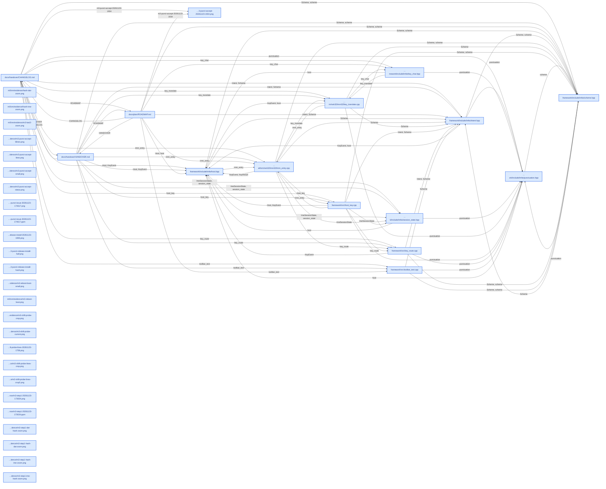

# 改造清单依赖图

- 生成时间：2026-11-23 20:10:41
- 改造文件：93 个
- 关联文件：-53 个（展开 2 层）

> 节点过多，已按层级截断 232 个；可收紧 --files 或降低 --depth。

## 终端视图

```
改造范围（L0）
├─ docs/handover/CHANGELOG.md
│   ├── ← docs/handover/HANDOVER.md　(L0，CHANGELOG)
│   └── ← docs/plan/ROADMAP.md　(L0，CHANGELOG)
├─ docs/handover/HANDOVER.md
│   ├── ← docs/handover/CHANGELOG.md　(L0，HANDOVER)
│   ├── ← docs/plan/ROADMAP.md　(L0，HANDOVER)
│   ├── ← tools/artifact_hashes.py　(L1，HANDOVER)
│   ├── ← tools/check_m1.py　(L0，HANDOVER)
│   ├── ← tools/make_release.py　(L1，HANDOVER)
│   └── ← tools/rhash/rhash.c　(L1，HANDOVER)
├─ docs/plan/ROADMAP.md
│   ├── ← docs/handover/CHANGELOG.md　(L0，ROADMAP)
│   ├── ← docs/handover/HANDOVER.md　(L0，ROADMAP)
│   └── ← tools/coverage_report.py　(L1，ROADMAP)
├─ framework/include/imfw/host.hpp
│   ├── ← build-host-off/tests/CMakeFiles/rospinyin-host-key.dir/compiler_depend.ts　(L1，host)
│   ├── ← build-host-off/tests/CMakeFiles/rospinyin-host-smoke.dir/compiler_depend.ts　(L1，host)
│   ├── ← docs/handover/CHANGELOG.md　(L0，Host, KeyEvent)
│   ├── ← docs/handover/HANDOVER.md　(L0，Host, KeyEvent)
│   ├── ← docs/plan/ROADMAP.md　(L0，Host, host)
│   ├── ← framework/include/imfw/candidate_pager.hpp　(L1，host)
│   ├── ← framework/include/imfw/code_table.hpp　(L1，host)
│   └── ← framework/include/imfw/dat_format.hpp　(L1，host)
│   └── …… 另有 53 个依赖方
├─ framework/include/imfw/intent.hpp
│   ├── ← docs/handover/CHANGELOG.md　(L0，Intent, Scheme)
│   ├── ← docs/handover/HANDOVER.md　(L0，Intent, Scheme)
│   ├── ← docs/plan/ROADMAP.md　(L0，Intent, Scheme)
│   ├── ← framework/include/imfw/code_table.hpp　(L1，Scheme)
│   ├── ← framework/include/imfw/host.hpp　(L0，Scheme)
│   ├── ← framework/include/imfw/scheme.hpp　(L0，Scheme)
│   ├── ← framework/include/imfw/scheme_registry.hpp　(L1，Scheme)
│   └── ← framework/include/imfw/toolbar_text.hpp　(L1，Scheme)
│   └── …… 另有 33 个依赖方
├─ framework/include/imfw/key_char.hpp
│   ├── ← docs/handover/CHANGELOG.md　(L0，key_char)
│   ├── ← docs/plan/ROADMAP.md　(L0，key_char)
│   ├── ← framework/platform/win32/imm32/key_translate.cpp　(L0，key_char)
│   └── ← tests/key_char_test.cpp　(L0，key_char)
├─ framework/include/imfw/punctuation.hpp
│   ├── ← build-host-off/tests/CMakeFiles/rospinyin-punctuation.dir/compiler_depend.ts　(L1，punctuation)
│   ├── ← docs/handover/CHANGELOG.md　(L0，punctuation)
│   ├── ← framework/include/imfw/intent.hpp　(L0，punctuation)
│   ├── ← framework/include/imfw/key_char.hpp　(L0，punctuation)
│   ├── ← framework/include/imfw/scheme.hpp　(L0，punctuation)
│   ├── ← framework/include/imfw/session_state.hpp　(L0，punctuation)
│   ├── ← framework/platform/win32/imm32/key_translate.cpp　(L0，punctuation)
│   └── ← framework/src/host_key.cpp　(L0，punctuation)
│   └── …… 另有 13 个依赖方
├─ framework/include/imfw/scheme.hpp
│   ├── ← build-host-off/tests/CMakeFiles/rospinyin-scheme-registry.dir/compiler_depend.ts　(L1，scheme)
│   ├── ← build-host-off/tests/CMakeFiles/rospinyin-scheme.dir/compiler_depend.ts　(L1，scheme)
│   ├── ← build-host-off/tests/CMakeFiles/rospinyin-toy-scheme.dir/compiler_depend.ts　(L1，scheme)
│   ├── ← docs/handover/CHANGELOG.md　(L0，Scheme, scheme)
│   ├── ← docs/handover/HANDOVER.md　(L0，Scheme, scheme)
│   ├── ← docs/plan/ROADMAP.md　(L0，Scheme, scheme)
│   ├── ← framework/include/imfw/code_table.hpp　(L1，scheme)
│   └── ← framework/include/imfw/host.hpp　(L0，Scheme, scheme)
│   └── …… 另有 39 个依赖方
├─ framework/include/imfw/session_state.hpp
│   ├── ← docs/handover/CHANGELOG.md　(L0，ImeSessionState, session_state)
│   ├── ← docs/handover/HANDOVER.md　(L0，ImeSessionState, session_state)
│   ├── ← framework/include/imfw/host.hpp　(L0，ImeSessionState, session_state)
│   ├── ← framework/include/imfw/toolbar_text.hpp　(L1，ImeSessionState)
│   ├── ← framework/platform/win32/imm32/ime_ui.h　(L1，ImeSessionState)
│   ├── ← framework/platform/win32/imm32/imm_entry.cpp　(L0，ImeSessionState)
│   ├── ← framework/platform/win32/imm32/session_store.cpp　(L1，ImeSessionState)
│   └── ← framework/platform/win32/imm32/session_store.hpp　(L1，ImeSessionState, session_state)
│   └── …… 另有 5 个依赖方
├─ framework/platform/win32/imm32/imm_entry.cpp
│   ├── ← docs/handover/CHANGELOG.md　(L0，imm_entry)
│   ├── ← docs/handover/HANDOVER.md　(L0，imm_entry)
│   ├── ← docs/plan/ROADMAP.md　(L0，imm_entry)
│   ├── ← framework/include/imfw/host.hpp　(L0，imm_entry)
│   ├── ← framework/include/imfw/session.hpp　(L1，imm_entry)
│   ├── ← framework/platform/win32/imm32/dllmain.cpp　(L1，imm_entry)
│   ├── ← framework/platform/win32/imm32/key_translate.cpp　(L0，imm_entry)
│   └── ← framework/platform/win32/imm32/trace_line.h　(L1，imm_entry)
│   └── …… 另有 6 个依赖方
├─ framework/platform/win32/imm32/key_translate.cpp
│   ├── ← docs/handover/CHANGELOG.md　(L0，key_translate)
│   ├── ← docs/handover/HANDOVER.md　(L0，key_translate)
│   ├── ← framework/include/imfw/key_char.hpp　(L0，key_translate)
│   ├── ← framework/platform/win32/imm32/imm_entry.cpp　(L0，key_translate)
│   ├── ← tests/key_char_test.cpp　(L0，key_translate)
│   └── ← tools/check_m1.py　(L0，key_translate)
├─ framework/src/host_key.cpp
│   ├── ← docs/handover/CHANGELOG.md　(L0，host_key)
│   ├── ← docs/handover/HANDOVER.md　(L0，host_key)
│   ├── ← framework/platform/win32/imm32/imm_entry.cpp　(L0，host_key)
│   ├── ← framework/platform/win32/imm32/key_translate.h　(L1，host_key)
│   ├── ← framework/platform/win32/imm32/win32_host.h　(L1，host_key)
│   ├── ← tools/check_m1.py　(L0，host_key)
│   └── ← tools/seams.py　(L0，host_key)
├─ framework/src/key_route.cpp
│   ├── ← docs/handover/CHANGELOG.md　(L0，key_route)
│   ├── ← docs/handover/HANDOVER.md　(L0，key_route)
│   ├── ← framework/platform/win32/imm32/imm_entry.cpp　(L0，key_route)
│   ├── ← framework/platform/win32/imm32/key_translate.h　(L1，key_route)
│   ├── ← framework/src/host_key.cpp　(L0，key_route)
│   ├── ← tools/check_m1.py　(L0，key_route)
│   └── ← tools/seams.py　(L0，key_route)
├─ framework/src/toolbar_text.cpp
│   ├── ← docs/handover/CHANGELOG.md　(L0，toolbar_text)
│   ├── ← docs/handover/HANDOVER.md　(L0，toolbar_text)
│   ├── ← docs/plan/ROADMAP.md　(L0，toolbar_text)
│   ├── ← framework/include/imfw/toolbar_text.hpp　(L1，toolbar_text)
│   ├── ← framework/platform/win32/ui/ime_ui.cpp　(L1，toolbar_text)
│   ├── ← framework/platform/win32/ui/toolbar.h　(L1，toolbar_text)
│   ├── ← tests/CMakeLists.txt　(L0，toolbar_text)
│   └── ← tests/toolbar_text_test.cpp　(L0，toolbar_text)
├─ m0/vm/evidence/hash-dat-zoom.png
├─ m0/vm/evidence/hash-ime-zoom.png
├─ m0/vm/evidence/m3-last2-zoom.png
├─ m0/vm/evidence/m3-punct-accept-20261123-1934.png
│   ├── ← docs/handover/CHANGELOG.md　(L0，m3-punct-accept-20261123-1934)
│   └── ← docs/plan/ROADMAP.md　(L0，m3-punct-accept-20261123-1934)
├─ m0/vm/evidence/m3-punct-accept-6lines.png
├─ m0/vm/evidence/m3-punct-accept-lines.png
├─ m0/vm/evidence/m3-punct-accept-small.png
├─ m0/vm/evidence/m3-punct-accept-status.png
├─ m0/vm/evidence/m3-punct-issue-20261123-174617.png
├─ m0/vm/evidence/m3-punct-issue-20261123-174617.ppm
├─ m0/vm/evidence/m3-punct-release-install-20261123-1900.png
├─ m0/vm/evidence/m3-punct-release-install-half.png
├─ m0/vm/evidence/m3-punct-release-install-hash.png
├─ m0/vm/evidence/m3-reboot-boot-small.png
├─ m0/vm/evidence/m3-reboot-boot.png
├─ m0/vm/evidence/m3-shift-probe-crop.png
├─ m0/vm/evidence/m3-shift-probe-current.png
├─ m0/vm/evidence/m3-shift-probe-lines-20261123-1758.png
├─ m0/vm/evidence/m3-shift-probe-lines-crop.png
├─ m0/vm/evidence/m3-shift-probe-lines-crop2.png
├─ m0/vm/evidence/m3-step1-20261123-173024.png
├─ m0/vm/evidence/m3-step1-20261123-173024.ppm
├─ m0/vm/evidence/m3-step1-dat-hash-zoom.png
├─ m0/vm/evidence/m3-step1-hash-dat-zoom.png
├─ m0/vm/evidence/m3-step1-hash-ime-zoom.png
├─ m0/vm/evidence/m3-step1-ime-hash-zoom.png
```

## 图（Mermaid）



## 分层

**改造范围（S1 清单内）**（40）
- `docs/handover/CHANGELOG.md`
- `docs/handover/HANDOVER.md`
- `docs/plan/ROADMAP.md`
- `framework/include/imfw/host.hpp`
- `framework/include/imfw/intent.hpp`
- `framework/include/imfw/key_char.hpp`
- `framework/include/imfw/punctuation.hpp`
- `framework/include/imfw/scheme.hpp`
- `framework/include/imfw/session_state.hpp`
- `framework/platform/win32/imm32/imm_entry.cpp`
- `framework/platform/win32/imm32/key_translate.cpp`
- `framework/src/host_key.cpp`
- `framework/src/key_route.cpp`
- `framework/src/toolbar_text.cpp`
- `m0/vm/evidence/hash-dat-zoom.png`
- `m0/vm/evidence/hash-ime-zoom.png`
- `m0/vm/evidence/m3-last2-zoom.png`
- `m0/vm/evidence/m3-punct-accept-20261123-1934.png`
- `m0/vm/evidence/m3-punct-accept-6lines.png`
- `m0/vm/evidence/m3-punct-accept-lines.png`
- `m0/vm/evidence/m3-punct-accept-small.png`
- `m0/vm/evidence/m3-punct-accept-status.png`
- `m0/vm/evidence/m3-punct-issue-20261123-174617.png`
- `m0/vm/evidence/m3-punct-issue-20261123-174617.ppm`
- `m0/vm/evidence/m3-punct-release-install-20261123-1900.png`
- `m0/vm/evidence/m3-punct-release-install-half.png`
- `m0/vm/evidence/m3-punct-release-install-hash.png`
- `m0/vm/evidence/m3-reboot-boot-small.png`
- `m0/vm/evidence/m3-reboot-boot.png`
- `m0/vm/evidence/m3-shift-probe-crop.png`
- `m0/vm/evidence/m3-shift-probe-current.png`
- `m0/vm/evidence/m3-shift-probe-lines-20261123-1758.png`
- `m0/vm/evidence/m3-shift-probe-lines-crop.png`
- `m0/vm/evidence/m3-shift-probe-lines-crop2.png`
- `m0/vm/evidence/m3-step1-20261123-173024.png`
- `m0/vm/evidence/m3-step1-20261123-173024.ppm`
- `m0/vm/evidence/m3-step1-dat-hash-zoom.png`
- `m0/vm/evidence/m3-step1-hash-dat-zoom.png`
- `m0/vm/evidence/m3-step1-hash-ime-zoom.png`
- `m0/vm/evidence/m3-step1-ime-hash-zoom.png`

## 依赖关系

| 依赖方 | 被依赖 | 引用符号 |
|---|---|---|
| `build-cross/CMakeFiles/4.5.1/CompilerIdC/CMakeCCompilerId.c` | `framework/platform/win32/imm32/session_store.cpp` | Store |
| `build-cross/CMakeFiles/4.5.1/CompilerIdC/CMakeCCompilerId.c` | `m0/vm/noVNC-1.5.0/core/util/cursor.js` | change |
| `build-cross/CMakeFiles/4.5.1/CompilerIdC/CMakeCCompilerId.c` | `tools/artifact_hashes.py` | when |
| `build-cross/CMakeFiles/4.5.1/CompilerIdC/CMakeCCompilerId.c` | `tools/syntax_stub/windows.h` | windows |
| `build-cross/CMakeFiles/4.5.1/CompilerIdCXX/CMakeCXXCompilerId.cpp` | `framework/platform/win32/imm32/session_store.cpp` | Store |
| `build-cross/CMakeFiles/4.5.1/CompilerIdCXX/CMakeCXXCompilerId.cpp` | `m0/vm/noVNC-1.5.0/core/util/cursor.js` | change |
| `build-cross/CMakeFiles/4.5.1/CompilerIdCXX/CMakeCXXCompilerId.cpp` | `tools/artifact_hashes.py` | when |
| `build-cross/CMakeFiles/4.5.1/CompilerIdCXX/CMakeCXXCompilerId.cpp` | `tools/syntax_stub/windows.h` | windows |
| `build-host-off/CMakeFiles/4.5.1/CompilerIdC/CMakeCCompilerId.c` | `framework/platform/win32/imm32/session_store.cpp` | Store |
| `build-host-off/CMakeFiles/4.5.1/CompilerIdC/CMakeCCompilerId.c` | `m0/vm/noVNC-1.5.0/core/util/cursor.js` | change |
| `build-host-off/CMakeFiles/4.5.1/CompilerIdC/CMakeCCompilerId.c` | `tools/artifact_hashes.py` | when |
| `build-host-off/CMakeFiles/4.5.1/CompilerIdC/CMakeCCompilerId.c` | `tools/syntax_stub/windows.h` | windows |
| `build-host-off/CMakeFiles/4.5.1/CompilerIdCXX/CMakeCXXCompilerId.cpp` | `framework/platform/win32/imm32/session_store.cpp` | Store |
| `build-host-off/CMakeFiles/4.5.1/CompilerIdCXX/CMakeCXXCompilerId.cpp` | `m0/vm/noVNC-1.5.0/core/util/cursor.js` | change |
| `build-host-off/CMakeFiles/4.5.1/CompilerIdCXX/CMakeCXXCompilerId.cpp` | `tools/artifact_hashes.py` | when |
| `build-host-off/CMakeFiles/4.5.1/CompilerIdCXX/CMakeCXXCompilerId.cpp` | `tools/syntax_stub/windows.h` | windows |
| `build-host-off/framework/CMakeFiles/imfw-engine.dir/compiler_depend.ts` | `framework/include/imfw/engine.hpp` | engine |
| `build-host-off/pinyin/CMakeFiles/rospinyin-engine.dir/compiler_depend.ts` | `framework/include/imfw/engine.hpp` | engine |
| `build-host-off/pinyin/CMakeFiles/rospinyin-engine.dir/compiler_depend.ts` | `ime/rospinyin.h` | rospinyin |
| `build-host-off/tests/CMakeFiles/rospinyin-builtin-gate.dir/compiler_depend.ts` | `ime/rospinyin.h` | rospinyin |
| `build-host-off/tests/CMakeFiles/rospinyin-candidate-pager.dir/compiler_depend.ts` | `ime/rospinyin.h` | rospinyin |
| `build-host-off/tests/CMakeFiles/rospinyin-code-table.dir/compiler_depend.ts` | `ime/rospinyin.h` | rospinyin |
| `build-host-off/tests/CMakeFiles/rospinyin-emit-text.dir/compiler_depend.ts` | `ime/rospinyin.h` | rospinyin |
| `build-host-off/tests/CMakeFiles/rospinyin-host-key.dir/compiler_depend.ts` | `framework/include/imfw/host.hpp` | host |
| `build-host-off/tests/CMakeFiles/rospinyin-host-smoke.dir/compiler_depend.ts` | `framework/include/imfw/host.hpp` | host |
| `build-host-off/tests/CMakeFiles/rospinyin-key-char.dir/compiler_depend.ts` | `ime/rospinyin.h` | rospinyin |
| `build-host-off/tests/CMakeFiles/rospinyin-key-route.dir/compiler_depend.ts` | `ime/rospinyin.h` | rospinyin |
| `build-host-off/tests/CMakeFiles/rospinyin-pinyin-session.dir/compiler_depend.ts` | `framework/include/imfw/session.hpp` | session |
| `build-host-off/tests/CMakeFiles/rospinyin-pinyin-session.dir/compiler_depend.ts` | `ime/rospinyin.h` | rospinyin |
| `build-host-off/tests/CMakeFiles/rospinyin-pinyin-session.dir/compiler_depend.ts` | `pinyin/include/rospinyin/pinyin.hpp` | pinyin |
| `build-host-off/tests/CMakeFiles/rospinyin-pinyin.dir/compiler_depend.ts` | `ime/rospinyin.h` | rospinyin |
| `build-host-off/tests/CMakeFiles/rospinyin-pinyin.dir/compiler_depend.ts` | `pinyin/include/rospinyin/pinyin.hpp` | pinyin |
| `build-host-off/tests/CMakeFiles/rospinyin-punctuation.dir/compiler_depend.ts` | `framework/include/imfw/punctuation.hpp` | punctuation |
| `build-host-off/tests/CMakeFiles/rospinyin-scheme-registry.dir/compiler_depend.ts` | `framework/include/imfw/scheme.hpp` | scheme |
| `build-host-off/tests/CMakeFiles/rospinyin-scheme.dir/compiler_depend.ts` | `framework/include/imfw/scheme.hpp` | scheme |
| `build-host-off/tests/CMakeFiles/rospinyin-session.dir/compiler_depend.ts` | `framework/include/imfw/session.hpp` | session |
| `build-host-off/tests/CMakeFiles/rospinyin-session.dir/compiler_depend.ts` | `ime/rospinyin.h` | rospinyin |
| `build-host-off/tests/CMakeFiles/rospinyin-smoke.dir/compiler_depend.ts` | `ime/rospinyin.h` | rospinyin |
| `build-host-off/tests/CMakeFiles/rospinyin-toolbar-text.dir/compiler_depend.ts` | `framework/platform/win32/ui/toolbar.h` | toolbar |
| `build-host-off/tests/CMakeFiles/rospinyin-toolbar-text.dir/compiler_depend.ts` | `ime/rospinyin.h` | rospinyin |
| `build-host-off/tests/CMakeFiles/rospinyin-toy-scheme.dir/compiler_depend.ts` | `framework/include/imfw/scheme.hpp` | scheme |
| `build-host-off/tests/CMakeFiles/rospinyin-utf8.dir/compiler_depend.ts` | `framework/include/imfw/utf8.hpp` | utf8 |
| `build-host-off/tests/CMakeFiles/rospinyin-utf8.dir/compiler_depend.ts` | `ime/rospinyin.h` | rospinyin |
| `build-host-off/tools/mkdat/CMakeFiles/mkdat.dir/compiler_depend.ts` | `tools/mkdat/mkdat.cpp` | mkdat |
| `build-standalone/CMakeFiles/4.5.0/CompilerIdC/CMakeCCompilerId.c` | `framework/platform/win32/imm32/session_store.cpp` | Store |
| `build-standalone/CMakeFiles/4.5.0/CompilerIdC/CMakeCCompilerId.c` | `m0/vm/noVNC-1.5.0/core/util/cursor.js` | change |
| `build-standalone/CMakeFiles/4.5.0/CompilerIdC/CMakeCCompilerId.c` | `tools/artifact_hashes.py` | when |
| `build-standalone/CMakeFiles/4.5.0/CompilerIdC/CMakeCCompilerId.c` | `tools/syntax_stub/windows.h` | windows |
| `build-standalone/CMakeFiles/4.5.0/CompilerIdCXX/CMakeCXXCompilerId.cpp` | `framework/platform/win32/imm32/session_store.cpp` | Store |
| `build-standalone/CMakeFiles/4.5.0/CompilerIdCXX/CMakeCXXCompilerId.cpp` | `m0/vm/noVNC-1.5.0/core/util/cursor.js` | change |
| `build-standalone/CMakeFiles/4.5.0/CompilerIdCXX/CMakeCXXCompilerId.cpp` | `tools/artifact_hashes.py` | when |
| `build-standalone/CMakeFiles/4.5.0/CompilerIdCXX/CMakeCXXCompilerId.cpp` | `tools/syntax_stub/windows.h` | windows |
| `build-tdd/CMakeFiles/4.5.0/CompilerIdC/CMakeCCompilerId.c` | `framework/platform/win32/imm32/session_store.cpp` | Store |
| `build-tdd/CMakeFiles/4.5.0/CompilerIdC/CMakeCCompilerId.c` | `m0/vm/noVNC-1.5.0/core/util/cursor.js` | change |
| `build-tdd/CMakeFiles/4.5.0/CompilerIdC/CMakeCCompilerId.c` | `tools/artifact_hashes.py` | when |
| `build-tdd/CMakeFiles/4.5.0/CompilerIdC/CMakeCCompilerId.c` | `tools/syntax_stub/windows.h` | windows |
| `build-tdd/CMakeFiles/4.5.0/CompilerIdCXX/CMakeCXXCompilerId.cpp` | `framework/platform/win32/imm32/session_store.cpp` | Store |
| `build-tdd/CMakeFiles/4.5.0/CompilerIdCXX/CMakeCXXCompilerId.cpp` | `m0/vm/noVNC-1.5.0/core/util/cursor.js` | change |
| `build-tdd/CMakeFiles/4.5.0/CompilerIdCXX/CMakeCXXCompilerId.cpp` | `tools/artifact_hashes.py` | when |
| `build-tdd/CMakeFiles/4.5.0/CompilerIdCXX/CMakeCXXCompilerId.cpp` | `tools/syntax_stub/windows.h` | windows |
| `build-tdd/CMakeFiles/4.5.1/CompilerIdC/CMakeCCompilerId.c` | `framework/platform/win32/imm32/session_store.cpp` | Store |
| `build-tdd/CMakeFiles/4.5.1/CompilerIdC/CMakeCCompilerId.c` | `m0/vm/noVNC-1.5.0/core/util/cursor.js` | change |
| `build-tdd/CMakeFiles/4.5.1/CompilerIdC/CMakeCCompilerId.c` | `tools/artifact_hashes.py` | when |
| `build-tdd/CMakeFiles/4.5.1/CompilerIdC/CMakeCCompilerId.c` | `tools/syntax_stub/windows.h` | windows |
| `build-tdd/CMakeFiles/4.5.1/CompilerIdCXX/CMakeCXXCompilerId.cpp` | `framework/platform/win32/imm32/session_store.cpp` | Store |
| `build-tdd/CMakeFiles/4.5.1/CompilerIdCXX/CMakeCXXCompilerId.cpp` | `m0/vm/noVNC-1.5.0/core/util/cursor.js` | change |
| `build-tdd/CMakeFiles/4.5.1/CompilerIdCXX/CMakeCXXCompilerId.cpp` | `tools/artifact_hashes.py` | when |
| `build-tdd/CMakeFiles/4.5.1/CompilerIdCXX/CMakeCXXCompilerId.cpp` | `tools/syntax_stub/windows.h` | windows |
| `docs/handover/CHANGELOG.md` | `docs/handover/HANDOVER.md` | HANDOVER |
| `docs/handover/CHANGELOG.md` | `docs/plan/ROADMAP.md` | ROADMAP |
| `docs/handover/CHANGELOG.md` | `framework/include/imfw/host.hpp` | Host, KeyEvent, KeyResult, host |
| `docs/handover/CHANGELOG.md` | `framework/include/imfw/intent.hpp` | Intent, Scheme, intent |
| `docs/handover/CHANGELOG.md` | `framework/include/imfw/key_char.hpp` | key_char |
| `docs/handover/CHANGELOG.md` | `framework/include/imfw/punctuation.hpp` | punctuation |
| `docs/handover/CHANGELOG.md` | `framework/include/imfw/scheme.hpp` | Scheme, scheme |
| `docs/handover/CHANGELOG.md` | `framework/include/imfw/session_state.hpp` | ImeSessionState, session_state |
| `docs/handover/CHANGELOG.md` | `framework/platform/win32/imm32/imm_entry.cpp` | imm_entry |
| `docs/handover/CHANGELOG.md` | `framework/platform/win32/imm32/key_translate.cpp` | key_translate |
| `docs/handover/CHANGELOG.md` | `framework/src/host_key.cpp` | host_key |
| `docs/handover/CHANGELOG.md` | `framework/src/key_route.cpp` | key_route |
| `docs/handover/CHANGELOG.md` | `framework/src/toolbar_text.cpp` | toolbar_text |
| `docs/handover/CHANGELOG.md` | `m0/vm/evidence/m3-punct-accept-20261123-1934.png` | m3-punct-accept-20261123-1934 |
| `docs/handover/CHANGELOG.md` | `pinyin/include/rospinyin/scheme.hpp` | PinyinScheme, scheme |
| `docs/handover/CHANGELOG.md` | `pinyin/src/scheme.cpp` | scheme |
| `docs/handover/CHANGELOG.md` | `tests/CMakeLists.txt` | CMakeLists |
| `docs/handover/CHANGELOG.md` | `tests/host_key_test.cpp` | host_key_test |
| `docs/handover/CHANGELOG.md` | `tests/key_route_test.cpp` | key_route_test |
| `docs/handover/CHANGELOG.md` | `tests/punctuation_test.cpp` | punctuation_test |
| `docs/handover/CHANGELOG.md` | `tests/toolbar_text_test.cpp` | toolbar_text_test |
| `docs/handover/CHANGELOG.md` | `tools/check_m1.py` | check, check_m1 |
| `docs/handover/CHANGELOG.md` | `tools/seams.py` | over_cap, seams |
| `docs/handover/HANDOVER.md` | `docs/handover/CHANGELOG.md` | CHANGELOG |
| `docs/handover/HANDOVER.md` | `docs/plan/ROADMAP.md` | ROADMAP |
| `docs/handover/HANDOVER.md` | `framework/include/imfw/host.hpp` | Host, KeyEvent, KeyResult, host |
| `docs/handover/HANDOVER.md` | `framework/include/imfw/intent.hpp` | Intent, Scheme, intent |
| `docs/handover/HANDOVER.md` | `framework/include/imfw/scheme.hpp` | Scheme, scheme |
| `docs/handover/HANDOVER.md` | `framework/include/imfw/session_state.hpp` | ImeSessionState, session_state |
| `docs/handover/HANDOVER.md` | `framework/platform/win32/imm32/imm_entry.cpp` | imm_entry |
| `docs/handover/HANDOVER.md` | `framework/platform/win32/imm32/key_translate.cpp` | key_translate |
| `docs/handover/HANDOVER.md` | `framework/src/host_key.cpp` | host_key |
| `docs/handover/HANDOVER.md` | `framework/src/key_route.cpp` | key_route |
| `docs/handover/HANDOVER.md` | `framework/src/toolbar_text.cpp` | toolbar_text |
| `docs/handover/HANDOVER.md` | `m0/vm/vnc_key.py` | keysym |
| `docs/handover/HANDOVER.md` | `pinyin/include/rospinyin/scheme.hpp` | PinyinScheme, scheme |
| `docs/handover/HANDOVER.md` | `pinyin/src/scheme.cpp` | scheme |
| `docs/handover/HANDOVER.md` | `tests/CMakeLists.txt` | CMakeLists |
| `docs/handover/HANDOVER.md` | `tests/host_key_test.cpp` | FakeEngine, SpyHost, host_key_test |
| `docs/handover/HANDOVER.md` | `tests/key_route_test.cpp` | OverlapScheme, key_route_test |
| `docs/handover/HANDOVER.md` | `tools/check_m1.py` | check, check_m1, read, strip_trace_blocks |
| `docs/handover/HANDOVER.md` | `tools/seams.py` | count, over_cap, seams, strip_comments |
| `docs/plan/ROADMAP.md` | `docs/handover/CHANGELOG.md` | CHANGELOG |
| `docs/plan/ROADMAP.md` | `docs/handover/HANDOVER.md` | HANDOVER |
| `docs/plan/ROADMAP.md` | `framework/include/imfw/host.hpp` | Host, host |
| `docs/plan/ROADMAP.md` | `framework/include/imfw/intent.hpp` | Intent, Scheme |
| `docs/plan/ROADMAP.md` | `framework/include/imfw/key_char.hpp` | key_char |
| `docs/plan/ROADMAP.md` | `framework/include/imfw/scheme.hpp` | Scheme, scheme |
| `docs/plan/ROADMAP.md` | `framework/platform/win32/imm32/imm_entry.cpp` | imm_entry |
| `docs/plan/ROADMAP.md` | `framework/src/toolbar_text.cpp` | toolbar_text |
| `docs/plan/ROADMAP.md` | `m0/vm/evidence/m3-punct-accept-20261123-1934.png` | m3-punct-accept-20261123-1934 |
| `docs/plan/ROADMAP.md` | `pinyin/include/rospinyin/scheme.hpp` | scheme |
