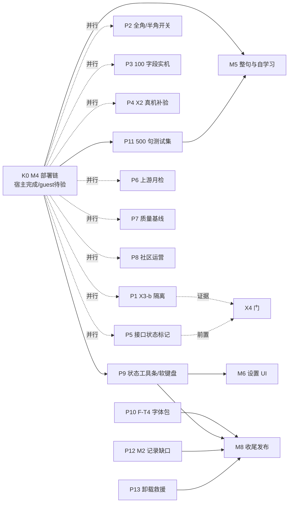

# 横切与并行工作统一排期（非 xingma）

> 2026-11-26 按 owner 要求建立。本文是 `PLAN.md` §13 的详表，把原先散落在 `PLAN.md` §10/§11、`PLAN-MODULARIZATION.md`、`ROADMAP.md` 与 `HANDOVER.md` 中“横切 / 并行 / 待排期 / 只立门”的工作统一登记。
> **范围排除**：`xingma/` 形码产品线的 W1 编码及其内部数据、图标、装配事项一律不列入；本表只管拼音主线与共享框架。
> **当前基线**：K0（M4 部署链路）宿主侧已完成（2026-11-26，dev-loop「M4 落地」轮次推进至 S3）；guest 实机待 owner 验收。本表的 P1–P14 排期口径不变。

## 1. 排期原则

1. **关键路径锚点单独标 K0**：M4 部署链路是当前唯一硬前置，其它能并行的项围绕它排，不能抢它的验收资源。
2. **有硬依赖的串行**：状态工具条/软键盘依赖 M3 状态机（已完成）与 M6 设置项，排在 M4 闭环之后、M6 之前；字体包收口排在 M8 发行工程之前。
3. **能并行的标“并行窗口”**：X3-b、M3 尾项、X2 真机补验、接口状态标记、上游月检、质量基线、社区运营均不占关键路径。
4. **门控项只登记触发条件**：X4 及更远的前置抽象不拍人日，触发后再按本文 G 项启动。
5. **每条都要有退出判据**：状态变更必须同步更新本文、`PLAN.md` §13 与 `ROADMAP.md` 的横切段落，不允许只改一处。

## 2. 关键路径锚点

| 编号 | 工作项 | 状态 | 排期位置 | 前置 / 依赖 | 退出判据 | 估时 | 依据 |
|---|---|---|---|---|---|---|---|
| K0 | **M4 部署链路**：词库内嵌 GUI 安装器 → `system32\` 固定 SHA-256 → 缺失/损坏拒绝加载 → `/status` → guest `nihao→你好` | ✅ 宿主完成 / ✅ 6080 实机闭环 / ⏳ 6081-6082 对照待补 | 先于 M5 | 安装器、release 资产、guest 步骤、加载链已同步改 | 宿主哈希校验 + 四类硬失败用例全绿（ctest 24/24、check_m1 120/120）；README / mklex README / ROADMAP / PLAN / HANDOVER 口径已二次同步；6080 实机截图 `check-install-20261126-2015.png`、`m4-phrase-6080-20261126-2026.png` 已归档 | 计入 M4 | `HANDOVER.md:192`、`PLAN.md:112`、`ROADMAP.md:172`、`.devloop/归档/第08轮/S2-实现.md` |

K0 的两个 S1 待定假设已由 owner 拍板并落地：**CLI `/step1..4` 同步写词库（含 SHA 双校验）**、**卸载清理词库**（2026-11-26 S0 裁决「CLI 同步 + 卸载清理」）。不单独排期。

## 3. 与 M4 并行、不占关键路径

| 编号 | 工作项 | 状态 | 排期位置 | 前置 / 依赖 | 退出判据 | 估时 | 依据 |
|---|---|---|---|---|---|---|---|
| P1 | **X3-b per-instance 隔离**：`g_hInst` / `g_stats` / `g_last_geometry` / `GlyphProbe` / `WindowRegistry` 五处全局可变状态收敛进会话上下文或显式加锁 | ⬜ 未开始 | 与 K0 并行，或推迟到 M7 前 | X3-a 已完成；不改 `framework/` 接入判据仍成立 | 同进程双 scheme 各打 3 键互不干扰；`framework/` 零 diff 机械证据不退化 | 1–2 人日 | `PLAN-MODULARIZATION.md:547-553,667`、`ROADMAP.md:75,210` |
| P2 | **M3 全角/半角独立开关**：解绑 `LanguageToggle` no-op，落实全/半角切换；独立中文标点开关按 S1 裁决 | ⏳ 待确认 | 与 K0 并行，M6 设置项前 | M3 状态机与共享标点表已落地 | 逐键切换中/英标点与全/半角，状态与工具栏 / 托盘一致；100 字段落中不出现无入口的状态 | 1–2 人日 | `HANDOVER.md:46,194,217,2432`、`ROADMAP.md:130,135` |
| P3 | **M3 100 字段落实机验收**（guest 手工） | ⏳ 待做 | 与 K0 的 guest 步骤同窗口安排 | M3 主体已完成 | 连续 100 字段落全程无异常，截图存 `m0/vm/evidence/` | 0.5–1 人日 | `HANDOVER.md:46,194`、`ROADMAP.md:121,131` |
| P4 | **X2 真机观感补验**：X2-w1/w2/w3、toy scheme、X2-a、X2-e1/e2 的上机确认 | ⏳ 待确认 | 与 K0 / P3 共用 guest 窗口 | 代码已合入 main，宿主门禁全绿 | 逐项真机观感确认入 `HANDOVER.md`；与 X3-a 的 `framework/` 零 diff 证据并列归档 | 1–2 人日 | `PLAN-MODULARIZATION.md:648,657,660,662`、`HANDOVER.md:2308,2422-2425` |
| P5 | **接口状态标记**：头文件 `status: freeze \| candidate \| draft`，并断言 draft 接口不进 DLL 导出 | ⬜ 未开始 | 与 P1 同期，X4 门之前 | X2-f seam 上限已落地 | `check_m1` 新增断言全绿；draft 接口零导出 | 0.5 人日 | `PLAN-MODULARIZATION.md:582,584,671` |
| P6 | **上游跟踪**：CORE-19268/18950/19455/20799/18923 月检；nightly 破坏性变更适配；CORE-18923 联动 M7 | 🔁 贯穿 | 每月首个工作日；重大变更当周 | 无 | 每月一条状态记录；nightly 破坏性变更在当周给出适配或不适配结论 | 不按人日计 | `PLAN.md:25-27,154`、`M0-REPORT.md:144` |
| P7 | **质量基线**：引擎单测覆盖率 ≥80%；每次发布前 ReactOS 冒烟清单 | 🔁 贯穿 / 每发布 | 每次发版门禁；M4/M5 新增代码后复测 | CI 门禁已存在 | 覆盖率报告入档；发布前 ReactOS 冒烟清单执行记录齐全。XP 双机比对按 `PLAN.md:47` 搁置，不作为门限 | 不按人日计 | `PLAN.md:155,47`、`HANDOVER.md:179` |
| P8 | **社区运营**：每里程碑一篇中英进展帖（JIRA + 论坛）；反馈 issue 分诊 | 🔁 贯穿 / 每里程碑 | 里程碑准出后 3 个工作日内 | 无 | 每个里程碑有对外帖与 issue 分诊记录；与 A3 / M8 发布渠道联动 | 不按人日计 | `PLAN.md:156,148-150`、`HANDOVER.md:51` |

## 4. M4 闭环后、M6 之前

| 编号 | 工作项 | 状态 | 排期位置 | 前置 / 依赖 | 退出判据 | 估时 | 依据 |
|---|---|---|---|---|---|---|---|
| P9 | **状态工具条与软键盘**（原 `PLAN.md` §11 全部 11.1–11.4） | ⬜ 已排期 | K0 闭环后启动，M6 前完成主体；11.3 持久化与 M6 7.1/7.2 合并实现 | M3 状态机 / 4.5 状态窗已完成；F-T3 未实现的工具栏点击并入 | 常驻可点击工具条 + 软键盘符号页实机 PASS；位置记忆与异常退出回归入 M8 9.1；README 增章节与截图 | 10–16 人日 | `PLAN.md:177-197,185,230` |
| P10 | **F-T4 独立可选字体包**（文津 P0/P2/P3 三件套 ≈57 MB） | ⚠️ 部分完成 | 与 K0 并行准备，M8 发行工程前收口 | D-F1（字体风格）拍板；安装器提示已完成，包体未制作 | 可复现打包脚本 + 授权与体积核对；`/status` 三态、`/u` 对称清理；不随主发行包分发 | 1–1.5 人日 | `PLAN.md:232-237`、`ROADMAP.md:103`、`README.md:17`、`HANDOVER.md:201` |
| P11 | **M4+ 词频调优 / 500 句测试集** | ⬜ 未开始 | K0 闭环后、M5 启动前 | K0 落地后才有真实词库链路 | 500 句样本自动评估首命中率入 CI 或独立报告；不宣称 ≥80% 直到实测 | 2–3 人日 | `PLAN.md:109-110`、`ROADMAP.md:154` |
| P12 | **M2 记录缺口**：验收截图归档 + 3.9–3.11 逐页图 | ⬜ 未闭环 | 可与 P7 / M8 文档并行 | 纯文档，无代码前置 | `M2-EXIT-GAP.md` 的四条缺口逐条销项 | 0.5 人日 | `PLAN.md:54`、`M2-EXIT-GAP.md:78-87,127` |

## 5. M8 收口

| 编号 | 工作项 | 状态 | 排期位置 | 前置 / 依赖 | 退出判据 | 估时 | 依据 |
|---|---|---|---|---|---|---|---|
| P13 | **卸载 + 安全模式救援文档** | ⬜ 未开始 | 随 M8 交付，策略在 K0 S1 先定 | 与 K0 的卸载清理词库假设联动 | 卸载幂等、救援步骤可在 guest 复现；Release 说明含升级警示 | 0.5–1 人日 | `M0-REDLINE-REVIEW.md:121`、`HANDOVER.md:51,217` |
| P14 | **异常退出回归与字体包收口** | ⬜ 未开始 | 并入 M8 9.1 / 9.3 | P9、P10 已完成 | 断电/杀进程后词库、设置、工具条状态不损坏；字体包随发行说明给出获取路径 | 计入 M8 | `PLAN.md:145,147,192`、`ROADMAP.md:194` |

## 6. 门控 / 未来触发（登记但不排人日）

| 编号 | 工作项 | 状态 | 触发条件 | 触发后先做 | 依据 |
|---|---|---|---|---|---|
| G1 | **X4 前端抽象** | 只立门，不排期 | 第二个前端消费者出现，或 `imm_entry.cpp` > 1,200 行，或 csrss 崩溃面成为真实痛感（任一） | 按当时最新代码重做 MANIFEST 逐文件处置；给 `on_key` 补 commit 输出通道 | `PLAN-MODULARIZATION.md:562-572,594`、`ROADMAP.md:76,210` |
| G2 | **阶段 2：引擎/UI 挪出 csrss（进程隔离）** | 不做 / 未排期 | 仅随 G1 重新评估 | 先证明确有第二个前端或 csrss 痛感 | `FRAMEWORK-ROUTE-A-REVIEW.md:242` |
| G3 | **C ABI 运行期插件工厂** | 由 X3 源码级接入替代 | 出现“第三方二进制、单独发版”需求 | 才冻结 ABI；不得提前写接口 | `PLAN-MODULARIZATION.md:555-556`、`FRAMEWORK-ROUTE-A-REVIEW.md:243` |
| G4 | **上游 64 位 / ARM64 兼容性** | 观察列表，不进 v1.0 支持矩阵 | CORE-18200 到“user-mode apps work”且 IMM32 启用有证据 | 阶段 0 宿主侧排雷：修 `offsetof` 断言、trace include、CI 加 64 位语法检查 | `PORTABILITY-UPSTREAM-64BIT-ARM64.md:13-14,140,148-167` |
| G5 | **Windows GUI 白名单登记 + 免费签名通道** | 本轮不做 / 可选 | 完成 5 项 Windows 真机最小验证；或误报成为真实阻塞 | 先验证清单，再谈 SignPath Foundation；不购买 EV/OV 证书 | `WINDOWS-GUI-COMPATIBILITY-ASSESSMENT.md:7-9,26-32`、`GUI-INSTALLER-FP-AND-WINDOWS-GUARD.md:36-42` |
| G6 | **TSF / Cicero 支持** | 明确非目标 | 仅在上游 TSF 落地后作为新项目评估 TIP 封装 | 不在本计划内启动 | `HANDOVER.md:37`、`ROADMAP.md:197` |
| G7 | **`tools/snapshot_sizes.py`** | 不排期 / 可选 | X4 触发需重做 MANIFEST 时 | 优先把行数并进 `ctest` / `check_m1` 输出 | `PLAN-MODULARIZATION.md:622-624`、`ARCH-AUDIT-VERIFICATION.md:186-189` |

## 7. 并行关系图

## 8. 估时与总口径

- 原 `PLAN.md` 里程碑合计：117–172 人日（不含 §11）。
- 本次新纳入的可量化工作：P1 + P2 + P3 + P4 + P5 + P9 + P10 + P11 + P12 + P13 = **18–30 人日**。
- 调整后 v1.0 总计：**135–202 人日**。P6/P7/P8 为贯穿项，不按人日重复计入；G1–G7 只在触发时另立轮次。
- K0 的部署工作已包含在 M4 14–18 人日内，不在此重复加总。
